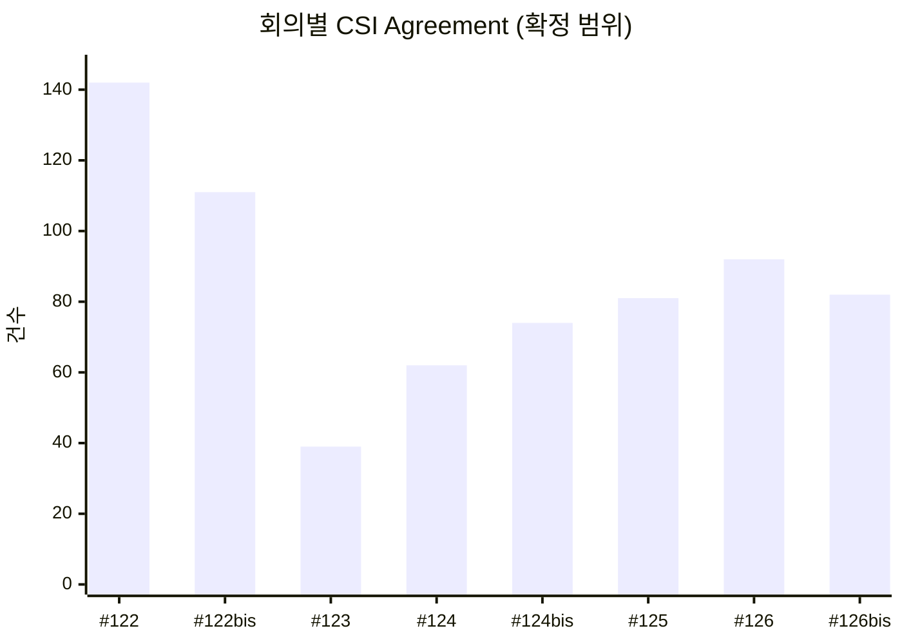

# RAN1 CSI 결정 대시보드

> 원본 DB 마지막 업데이트 **2026-10-21 09:04 KST** · 범위 RAN1#122 – #126bis (8회) · [HTML 대시보드](https://jgunmoon.github.io/RAN1-CSI-Dashboard/) · 원본 [jgunmoon/RAN1-Decision-Tracker](https://github.com/jgunmoon/RAN1-Decision-Tracker)

> ⚠️ **Agenda 확인 필요 (RAN1#126 → RAN1#126bis)** — 결정이 범위에서 조용히 빠지지 않도록 확인하세요.
>
> - 새 Agenda **10.3.2 Modulation** (Rel-20 Study of 6GR): 확정 0 · 후보 1 / 전체 5건. CSI Agenda면 agendas에 넣습니다.

3GPP RAN1 Chair notes의 결정 중 CSI 관련(CSI 획득·보고, CSI-RS, codebook, beam management, SRS, AI/ML CSI)만 모았습니다.
범위·주제 규칙은 [`config/csi_scope.yaml`](../config/csi_scope.yaml)에 있습니다. 이 파일은 자동 생성물이므로 직접 고치지 않습니다.

| 구분 | 건수 |
|---|---:|
| 확정 (포함 Agenda + 수동 포함) | **733** (Agreement 683 · WA 4 · Conclusion 46) |
| 후보 (다른 Agenda의 키워드 일치, 확인 필요) | 210 |

## 직전 회의 대비 (RAN1#126 → RAN1#126bis)

확정 범위의 Agreement 수입니다. RAN1#126bis의 결정은 모두 이번 회의의 신규 결정입니다.

| 주제 | #126 | **#126bis** | 증감 |
|---|---:|---:|---:|
| [AI/ML CSI](by_topic/aiml.md) | 10 | **7** | -3 |
| [SRS](by_topic/srs.md) | 26 | **24** | -2 |
| [Beam management](by_topic/beam.md) | 31 | **18** | -13 |
| [CSI 보고/codebook](by_topic/report.md) | 13 | **17** | +4 |
| [CSI-RS](by_topic/csirs.md) | 9 | **5** | -4 |
| [기타 CSI](by_topic/other.md) | 3 | **11** | +8 |
| **합계** | 92 | **82** | -10 |

## 주제별 · 회의별 Agreement

확정 범위의 Agreement만 셉니다. Working Assumption·Conclusion과 후보는 HTML 대시보드에서 체크박스로 켤 수 있습니다.
회의별 숫자는 결정마다 하나인 **주된 주제**로 셉니다. 한 결정이 여러 주제에 걸치면 나머지는 **관련 주제**로 붙고,
맨 끝 '관련 포함' 열은 관련 주제까지 센 전체 회의 합계라 합계가 전체 건수보다 큽니다.

| 주된 주제 | #122 | #122bis | #123 | #124 | #124bis | #125 | #126 | #126bis | 합계 | 관련 포함 |
|---|---:|---:|---:|---:|---:|---:|---:|---:|---:|---:|
| [AI/ML CSI](by_topic/aiml.md) | 58 | 43 | 15 | 17 | 15 | 13 | 10 | 7 | **178** | 192 |
| [SRS](by_topic/srs.md) | 28 | 16 | 9 | 17 | 25 | 21 | 26 | 24 | **166** | 178 |
| [Beam management](by_topic/beam.md) | 15 | 3 | 3 | 15 | 11 | 22 | 31 | 18 | **118** | 139 |
| [CSI 보고/codebook](by_topic/report.md) | 21 | 33 | 5 | 8 | 14 | 14 | 13 | 17 | **125** | 373 |
| [CSI-RS](by_topic/csirs.md) | 4 | 1 | 1 | 4 | 8 | 9 | 9 | 5 | **41** | 189 |
| [기타 CSI](by_topic/other.md) | 16 | 15 | 6 | 1 | 1 | 2 | 3 | 11 | **55** | 55 |
| **합계** | **142** | **111** | **39** | **62** | **74** | **81** | **92** | **82** | **683** | — |

## 포함 Agenda별 · 회의별 Agreement

Agenda 번호는 회의마다 바뀌므로 '섹션 + Agenda 제목'으로 이어 붙였습니다. 괄호 안 번호는 가장 최근 회의 번호입니다.

| Agenda | #122 | #122bis | #123 | #124 | #124bis | #125 | #126 | #126bis | 합계 |
|---|---:|---:|---:|---:|---:|---:|---:|---:|---:|
| Aspects of downlink-based CSI acquisition (Rel-20 Study of 6GR, 최근 10.5.3.1) | · | · | · | 5 | 17 | 18 | 20 | 21 | **81** |
| Aspects of uplink-based CSI acquisition (Rel-20 Study of 6GR, 최근 10.5.3.2) | · | · | · | 5 | 14 | 9 | 7 | 12 | **47** |
| Beam management for downlink and uplink (Rel-20 Study of 6GR, 최근 10.5.3.4) | · | · | · | 4 | 9 | 13 | 12 | 9 | **47** |
| Synchronization acquisition and beam measurement (Rel-20 Study of 6GR, 최근 10.5.1.1) | · | · | · | 6 | 1 | 8 | 15 | 8 | **38** |
| CSI acquisition and report: Other aspects (TRS, DL+UL 결합 CSI 등) (Rel-20 Study of 6GR, 최근 10.5.3.3) | · | · | · | 5 | 9 | 5 | 8 | 12 | **39** |
| NR MIMO Phase 6 (상위 Agenda) (Release 20 NR, 최근 9.2) | · | · | · | · | 7 | 14 | 15 | 12 | **48** |
| Enhancing DL CSI acquisition (Release 20 NR, 최근 9.2.2) | 8 | 12 | 5 | 9 | · | · | · | · | **34** |
| Improvement of SRS capacity and coverage (Release 20 NR, 최근 9.2.1) | 7 | 7 | 8 | 5 | · | · | · | · | **27** |
| AI/ML CSI compression Case 0 (Inference related aspects 등 하위 포함) (Release 20 NR, 최근 9.1.1) | 10 | 10 | 9 | 5 | 5 | 4 | 4 | 4 | **51** |
| Inter-vendor training collaboration for two-sided AI/ML models (Release 20 NR, 최근 9.1.2) | 5 | 2 | 2 | 4 | 3 | 5 | 4 | 2 | **27** |
| UE features for NR MIMO Phase N (Rel-19 UE Features, 최근 9.2) | 49 | 31 | · | · | · | · | · | · | **80** |
| Maintenance on NR MIMO Phase N (하위 포함) (Maintenance on Rel-19 NR and E-UTRA, 최근 8.2) | 20 | 18 | 11 | 8 | 7 | · | · | · | **64** |
| UE features for AI/ML (positioning 제외) (Rel-19 UE Features, 최근 9.1) | 19 | 18 | · | · | · | · | · | · | **37** |
| Maintenance on AI/ML (positioning 제외) (Maintenance on Rel-19 NR and E-UTRA, 최근 8.1) | 3 | 13 | 4 | 6 | 2 | · | · | · | **28** |
| Maintenance on AI/ML·MIMO Ph5·NES·NTN (CSI 키워드·조항 있는 결정만) (Maintenance on Rel-19 NR and E-UTRA, 최근 8.1) | · | · | · | · | · | 5 | 7 | 2 | **14** |
| AI/ML: Specification support for beam management (Maintenance on Rel-19 NR and E-UTRA, 최근 8.1.1) | 12 | · | · | · | · | · | · | · | **12** |
| AI/ML: Specification support for CSI prediction (Maintenance on Rel-19 NR and E-UTRA, 최근 8.1.3) | 9 | · | · | · | · | · | · | · | **9** |
| **합계** | **142** | **111** | **39** | **62** | **74** | **81** | **92** | **82** | **683** |

## RAN1#126bis 신규 CSI Agreement (82건)

아래 문장은 요약이 아니라 **원문 첫 줄**입니다(길면 자름). 전체 원문은 주제별 리포트와 HTML 대시보드에 있습니다.

| 주제 | Agenda | 원문 첫 줄 | 출처 |
|---|---|---|---|
| CSI 보고/codebook | 8.1 Maintenance on AI/ML for NR Air interface, NR MIMO Phase 5,  NES and NTN for NR and IoT | The draft CR in R1-2607797 for Rel-19 TS38.214, Clause 5.2.2.5 is endorsed. | [Chair notes RAN1#126bis_eom1](https://www.3gpp.org/ftp/tsg_ran/WG1_RL1/TSGR1_126b/Inbox/Chair_notes/Chair%20notes%20RAN1%23126bis_eom1.docx) · `[126bis-R19-AI 8.1]` |
| CSI 보고/codebook | 8.1 Maintenance on AI/ML for NR Air interface, NR MIMO Phase 5,  NES and NTN for NR and IoT | Proposal 1 in Section 4 of R1-2608695 for Rel-19, TS38.214, Clause 5.2.5 is endorsed. | [Chair notes RAN1#126bis_eom1](https://www.3gpp.org/ftp/tsg_ran/WG1_RL1/TSGR1_126b/Inbox/Chair_notes/Chair%20notes%20RAN1%23126bis_eom1.docx) · `[126bis-R19-AI 8.1]` |
| AI/ML CSI | 9.1.1 CSI spatial/frequency compression without temporal aspects (“Case 0”) | Support following configuration for NW data collection | [Chair notes RAN1#126bis_eom1](https://www.3gpp.org/ftp/tsg_ran/WG1_RL1/TSGR1_126b/Inbox/Chair_notes/Chair%20notes%20RAN1%23126bis_eom1.docx) |
| AI/ML CSI | 9.1.1 CSI spatial/frequency compression without temporal aspects (“Case 0”) | With respect to RAN2 LS in R1-2606980 (R2-2606052), the draft LS response in R1-2608768 is endorsed. | [Chair notes RAN1#126bis_eom1](https://www.3gpp.org/ftp/tsg_ran/WG1_RL1/TSGR1_126b/Inbox/Chair_notes/Chair%20notes%20RAN1%23126bis_eom1.docx) · [R1-2608402](https://www.3gpp.org/ftp/tsg_ran/WG1_RL1/TSGR1_126b/Docs/R1-2608402.zip) |
| AI/ML CSI | 9.1.1 CSI spatial/frequency compression without temporal aspects (“Case 0”) | For CSI feedback via two-sided model, for inference only, reuse the legacy R19 APU and CPU framework consider… | [Chair notes RAN1#126bis_eom1](https://www.3gpp.org/ftp/tsg_ran/WG1_RL1/TSGR1_126b/Inbox/Chair_notes/Chair%20notes%20RAN1%23126bis_eom1.docx) · [R1-2608403](https://www.3gpp.org/ftp/tsg_ran/WG1_RL1/TSGR1_126b/Docs/R1-2608403.zip) |
| AI/ML CSI | 9.1.1 CSI spatial/frequency compression without temporal aspects (“Case 0”) | For CSI feedback via two-sided model, for inference only, support CSI processing timeline {Z+t’, Z’+t’} where… | [Chair notes RAN1#126bis_eom1](https://www.3gpp.org/ftp/tsg_ran/WG1_RL1/TSGR1_126b/Inbox/Chair_notes/Chair%20notes%20RAN1%23126bis_eom1.docx) · [R1-2608403](https://www.3gpp.org/ftp/tsg_ran/WG1_RL1/TSGR1_126b/Docs/R1-2608403.zip) |
| AI/ML CSI | 9.1.2 Inter-vendor training collaboration for two-sided AI/ML models | Regarding RAN2 LS R1-2606975 (R2-2605892), the draft LS R1-2608708 is endorsed after making the following cha… | [Chair notes RAN1#126bis_eom1](https://www.3gpp.org/ftp/tsg_ran/WG1_RL1/TSGR1_126b/Inbox/Chair_notes/Chair%20notes%20RAN1%23126bis_eom1.docx) |
| AI/ML CSI | 9.1.2 Inter-vendor training collaboration for two-sided AI/ML models | - For model applicability procedure for inference, supports Option A and option B. | [Chair notes RAN1#126bis_eom1](https://www.3gpp.org/ftp/tsg_ran/WG1_RL1/TSGR1_126b/Inbox/Chair_notes/Chair%20notes%20RAN1%23126bis_eom1.docx) |
| 기타 CSI | 9.2 NR MIMO Phase 6 | The draft LS to RAN2 in R1-2608676 is endorsed. The final LS in R1-2608623 is agreed. | [Chair notes RAN1#126bis_eom1](https://www.3gpp.org/ftp/tsg_ran/WG1_RL1/TSGR1_126b/Inbox/Chair_notes/Chair%20notes%20RAN1%23126bis_eom1.docx) · [R1-2608676](https://www.3gpp.org/ftp/tsg_ran/WG1_RL1/TSGR1_126b/Docs/R1-2608676.zip) · `[126bis-R20-MIMO]` |
| SRS | 9.2 NR MIMO Phase 6 | The first slot as the reference slot in the following agreement is determined based on the numerology of the … | [Chair notes RAN1#126bis_eom1](https://www.3gpp.org/ftp/tsg_ran/WG1_RL1/TSGR1_126b/Inbox/Chair_notes/Chair%20notes%20RAN1%23126bis_eom1.docx) · [R1-2607052](https://www.3gpp.org/ftp/tsg_ran/WG1_RL1/TSGR1_126b/Docs/R1-2607052.zip) · `[126bis-R20-MIMO]` |
| SRS | 9.2 NR MIMO Phase 6 | Support a per-cell new RRC parameter to disable/enable Rel-20 early SRS triggering for a SCell switching out … | [Chair notes RAN1#126bis_eom1](https://www.3gpp.org/ftp/tsg_ran/WG1_RL1/TSGR1_126b/Inbox/Chair_notes/Chair%20notes%20RAN1%23126bis_eom1.docx) · [R1-2607052](https://www.3gpp.org/ftp/tsg_ran/WG1_RL1/TSGR1_126b/Docs/R1-2607052.zip) · `[126bis-R20-MIMO]` |
| CSI 보고/codebook | 9.2 NR MIMO Phase 6 | On MAC-CE triggering indication for early CSI/CSI-RS based on a SCell activation command, study the following… | [Chair notes RAN1#126bis_eom1](https://www.3gpp.org/ftp/tsg_ran/WG1_RL1/TSGR1_126b/Inbox/Chair_notes/Chair%20notes%20RAN1%23126bis_eom1.docx) · [R1-2607054](https://www.3gpp.org/ftp/tsg_ran/WG1_RL1/TSGR1_126b/Docs/R1-2607054.zip) · `[126bis-R20-MIMO]` |
| SRS | 9.2 NR MIMO Phase 6 | For early aperiodic SRS/CSI/CSI-RS triggered via SCell activation command or DCI indicating switching out of … | [Chair notes RAN1#126bis_eom1](https://www.3gpp.org/ftp/tsg_ran/WG1_RL1/TSGR1_126b/Inbox/Chair_notes/Chair%20notes%20RAN1%23126bis_eom1.docx) · [R1-2607054](https://www.3gpp.org/ftp/tsg_ran/WG1_RL1/TSGR1_126b/Docs/R1-2607054.zip) · `[126bis-R20-MIMO]` |
| SRS | 9.2 NR MIMO Phase 6 | To determine the transmission/reception slot of the DL/UL signalling triggered/scheduled via the DCI indicati… | [Chair notes RAN1#126bis_eom1](https://www.3gpp.org/ftp/tsg_ran/WG1_RL1/TSGR1_126b/Inbox/Chair_notes/Chair%20notes%20RAN1%23126bis_eom1.docx) · [R1-2607055](https://www.3gpp.org/ftp/tsg_ran/WG1_RL1/TSGR1_126b/Docs/R1-2607055.zip) · `[126bis-R20-MIMO]` |
| SRS | 9.2 NR MIMO Phase 6 | MSG4-triggered CSI/TRS/SRS must be in the initial BWP. | [Chair notes RAN1#126bis_eom1](https://www.3gpp.org/ftp/tsg_ran/WG1_RL1/TSGR1_126b/Inbox/Chair_notes/Chair%20notes%20RAN1%23126bis_eom1.docx) · [R1-2607055](https://www.3gpp.org/ftp/tsg_ran/WG1_RL1/TSGR1_126b/Docs/R1-2607055.zip) · `[126bis-R20-MIMO]` |
| SRS | 9.2 NR MIMO Phase 6 | For PF = K (i.e., PF = 2, K = 2 and PF = 4, K = 4): | [Chair notes RAN1#126bis_eom1](https://www.3gpp.org/ftp/tsg_ran/WG1_RL1/TSGR1_126b/Inbox/Chair_notes/Chair%20notes%20RAN1%23126bis_eom1.docx) · [R1-2607397](https://www.3gpp.org/ftp/tsg_ran/WG1_RL1/TSGR1_126b/Docs/R1-2607397.zip) · `[126bis-R20-MIMO]` |
| SRS | 9.2 NR MIMO Phase 6 | When the parameter hoppingWithRepetition is set to repetition, for a repetition spanning two consecutive slot… | [Chair notes RAN1#126bis_eom1](https://www.3gpp.org/ftp/tsg_ran/WG1_RL1/TSGR1_126b/Inbox/Chair_notes/Chair%20notes%20RAN1%23126bis_eom1.docx) · [R1-2607398](https://www.3gpp.org/ftp/tsg_ran/WG1_RL1/TSGR1_126b/Docs/R1-2607398.zip) · `[126bis-R20-MIMO]` |
| SRS | 9.2 NR MIMO Phase 6 | Regarding the RPFS start RB index hopping across multiple legacy SRS frequency hopping periods determined by … | [Chair notes RAN1#126bis_eom1](https://www.3gpp.org/ftp/tsg_ran/WG1_RL1/TSGR1_126b/Inbox/Chair_notes/Chair%20notes%20RAN1%23126bis_eom1.docx) · [R1-2607398](https://www.3gpp.org/ftp/tsg_ran/WG1_RL1/TSGR1_126b/Docs/R1-2607398.zip) · `[126bis-R20-MIMO]` |
| SRS | 9.2 NR MIMO Phase 6 | Regarding the RPFS start RB index hopping across multiple legacy SRS frequency hopping periods determined by … | [Chair notes RAN1#126bis_eom1](https://www.3gpp.org/ftp/tsg_ran/WG1_RL1/TSGR1_126b/Inbox/Chair_notes/Chair%20notes%20RAN1%23126bis_eom1.docx) · [R1-2607398](https://www.3gpp.org/ftp/tsg_ran/WG1_RL1/TSGR1_126b/Docs/R1-2607398.zip) · `[126bis-R20-MIMO]` |
| SRS | 9.2 NR MIMO Phase 6 | For PF = K (i.e., PF = 2, K = 2 and PF = 4, K = 4), update  as follows: | [Chair notes RAN1#126bis_eom1](https://www.3gpp.org/ftp/tsg_ran/WG1_RL1/TSGR1_126b/Inbox/Chair_notes/Chair%20notes%20RAN1%23126bis_eom1.docx) · [R1-2607398](https://www.3gpp.org/ftp/tsg_ran/WG1_RL1/TSGR1_126b/Docs/R1-2607398.zip) · `[126bis-R20-MIMO]` |
| Beam management | 10.5.1.1 Synchronization acquisition and beam measurement | The following templates are used to capture the coverage gap relative to the basic coverage of 143 dB MaxCL a… | [Chair notes RAN1#126bis_eom1](https://www.3gpp.org/ftp/tsg_ran/WG1_RL1/TSGR1_126b/Inbox/Chair_notes/Chair%20notes%20RAN1%23126bis_eom1.docx) · `[126bis-R20-6GR-Synchronization and Beam Measurement]` |
| Beam management | 10.5.1.1 Synchronization acquisition and beam measurement | 6GR supports configurable Timing Advance Offset | [Chair notes RAN1#126bis_eom1](https://www.3gpp.org/ftp/tsg_ran/WG1_RL1/TSGR1_126b/Inbox/Chair_notes/Chair%20notes%20RAN1%23126bis_eom1.docx) · `[126bis-R20-6GR-Synchronization and Beam Measurement]` |
| Beam management | 10.5.1.1 Synchronization acquisition and beam measurement | - One 6GR SSB spans X OFDM symbols within a slot, where X is down-selected from {4, 5, 6} | [Chair notes RAN1#126bis_eom1](https://www.3gpp.org/ftp/tsg_ran/WG1_RL1/TSGR1_126b/Inbox/Chair_notes/Chair%20notes%20RAN1%23126bis_eom1.docx) · `[126bis-R20-6GR-Synchronization and Beam Measurement]` |
| Beam management | 10.5.1.1 Synchronization acquisition and beam measurement | For 6GR TN, the maximum number of candidate SSB beams within one 6GR SSB period L is | [Chair notes RAN1#126bis_eom1](https://www.3gpp.org/ftp/tsg_ran/WG1_RL1/TSGR1_126b/Inbox/Chair_notes/Chair%20notes%20RAN1%23126bis_eom1.docx) · `[126bis-R20-6GR-Synchronization and Beam Measurement]` |
| Beam management | 10.5.1.1 Synchronization acquisition and beam measurement | RAN1 to down-select from the following options | [Chair notes RAN1#126bis_eom1](https://www.3gpp.org/ftp/tsg_ran/WG1_RL1/TSGR1_126b/Inbox/Chair_notes/Chair%20notes%20RAN1%23126bis_eom1.docx) · `[126bis-R20-6GR-Synchronization and Beam Measurement]` |
| Beam management | 10.5.1.1 Synchronization acquisition and beam measurement | Study Sub-case D in R1-2600986 with focusing on potential spec impact of AI/ML based spatial/temporal beam pr… | [Chair notes RAN1#126bis_eom1](https://www.3gpp.org/ftp/tsg_ran/WG1_RL1/TSGR1_126b/Inbox/Chair_notes/Chair%20notes%20RAN1%23126bis_eom1.docx) · `[126bis-R20-6GR-Synchronization and Beam Measurement]` |
| Beam management | 10.5.1.1 Synchronization acquisition and beam measurement | For the further study of PSS and SSS (including sequence type, sequence length and number of sequences, numbe… | [Chair notes RAN1#126bis_eom1](https://www.3gpp.org/ftp/tsg_ran/WG1_RL1/TSGR1_126b/Inbox/Chair_notes/Chair%20notes%20RAN1%23126bis_eom1.docx) · `[126bis-R20-6GR-Synchronization and Beam Measurement]` |
| Beam management | 10.5.1.1 Synchronization acquisition and beam measurement | For the further study of PSS and SSS (including sequence type, sequence length and number of sequences, numbe… | [Chair notes RAN1#126bis_eom1](https://www.3gpp.org/ftp/tsg_ran/WG1_RL1/TSGR1_126b/Inbox/Chair_notes/Chair%20notes%20RAN1%23126bis_eom1.docx) · `[126bis-R20-6GR-Synchronization and Beam Measurement]` |
| CSI 보고/codebook | 10.5.3.1 Aspects of downlink-based CSI acquisition | For the 6GR CJT report to facilitate CJT deployment, | [Chair notes RAN1#126bis_eom1](https://www.3gpp.org/ftp/tsg_ran/WG1_RL1/TSGR1_126b/Inbox/Chair_notes/Chair%20notes%20RAN1%23126bis_eom1.docx) · `[126bis-R20-6GR-Aspects of DL based CSI acquisition]` |
| CSI 보고/codebook | 10.5.3.1 Aspects of downlink-based CSI acquisition | For the study of the 6GR codebook design for CSI report, regarding the SD basis selection for the high-resolu… | [Chair notes RAN1#126bis_eom1](https://www.3gpp.org/ftp/tsg_ran/WG1_RL1/TSGR1_126b/Inbox/Chair_notes/Chair%20notes%20RAN1%23126bis_eom1.docx) · `[126bis-R20-6GR-Aspects of DL based CSI acquisition]` |
| CSI-RS | 10.5.3.1 Aspects of downlink-based CSI acquisition | For 6GR CSI-RS, for discussion purpose of CSI-RS frequency domain behavior, | [Chair notes RAN1#126bis_eom1](https://www.3gpp.org/ftp/tsg_ran/WG1_RL1/TSGR1_126b/Inbox/Chair_notes/Chair%20notes%20RAN1%23126bis_eom1.docx) · `[126bis-R20-6GR-Aspects of DL based CSI acquisition]` |
| CSI-RS | 10.5.3.1 Aspects of downlink-based CSI acquisition | Support PN sequence with QPSK modulation as the 6GR CSI-RS sequence | [Chair notes RAN1#126bis_eom1](https://www.3gpp.org/ftp/tsg_ran/WG1_RL1/TSGR1_126b/Inbox/Chair_notes/Chair%20notes%20RAN1%23126bis_eom1.docx) · `[126bis-R20-6GR-Aspects of DL based CSI acquisition]` |
| CSI 보고/codebook | 10.5.3.1 Aspects of downlink-based CSI acquisition | For 6GR CSI-RS, to study the threshold X on whether M1 is larger than 1, and the detailed (M1, M2) values, th… | [Chair notes RAN1#126bis_eom1](https://www.3gpp.org/ftp/tsg_ran/WG1_RL1/TSGR1_126b/Inbox/Chair_notes/Chair%20notes%20RAN1%23126bis_eom1.docx) · `[126bis-R20-6GR-Aspects of DL based CSI acquisition]` |
| CSI 보고/codebook | 10.5.3.1 Aspects of downlink-based CSI acquisition | For 6GR CSI-RS study, the following template is adopted to collect evaluation results for CSI-RS pattern desi… | [Chair notes RAN1#126bis_eom1](https://www.3gpp.org/ftp/tsg_ran/WG1_RL1/TSGR1_126b/Inbox/Chair_notes/Chair%20notes%20RAN1%23126bis_eom1.docx) · `[126bis-R20-6GR-Aspects of DL based CSI acquisition]` |
| CSI 보고/codebook | 10.5.3.1 Aspects of downlink-based CSI acquisition | For 6G CSI-RS sequence design, the following template is adopted to collect evaluation results | [Chair notes RAN1#126bis_eom1](https://www.3gpp.org/ftp/tsg_ran/WG1_RL1/TSGR1_126b/Inbox/Chair_notes/Chair%20notes%20RAN1%23126bis_eom1.docx) · `[126bis-R20-6GR-Aspects of DL based CSI acquisition]` |
| CSI 보고/codebook | 10.5.3.1 Aspects of downlink-based CSI acquisition | On the pattern for CSI-IM in 6G, both pattern 0 (2x2 resource grid) and pattern 1 (4x1 resource grid) defined… | [Chair notes RAN1#126bis_eom1](https://www.3gpp.org/ftp/tsg_ran/WG1_RL1/TSGR1_126b/Inbox/Chair_notes/Chair%20notes%20RAN1%23126bis_eom1.docx) · `[126bis-R20-6GR-Aspects of DL based CSI acquisition]` |
| AI/ML CSI | 10.5.3.1 Aspects of downlink-based CSI acquisition | For the study of time-domain CSI prediction at UE side in 6GR, among UE-side prediction schemes, consider N4=… | [Chair notes RAN1#126bis_eom1](https://www.3gpp.org/ftp/tsg_ran/WG1_RL1/TSGR1_126b/Inbox/Chair_notes/Chair%20notes%20RAN1%23126bis_eom1.docx) · `[126bis-R20-6GR-Aspects of DL based CSI acquisition]` |
| CSI 보고/codebook | 10.5.3.1 Aspects of downlink-based CSI acquisition | - For 6G CSI-RS study, assuming different cells use different scrambling IDs for sequence initialization, ide… | [Chair notes RAN1#126bis_eom1](https://www.3gpp.org/ftp/tsg_ran/WG1_RL1/TSGR1_126b/Inbox/Chair_notes/Chair%20notes%20RAN1%23126bis_eom1.docx) · `[126bis-R20-6GR-Aspects of DL based CSI acquisition]` |
| CSI 보고/codebook | 10.5.3.1 Aspects of downlink-based CSI acquisition | For the evaluation of configurable/downloadable codebook/basis, at least the following can be considered: | [Chair notes RAN1#126bis_eom1](https://www.3gpp.org/ftp/tsg_ran/WG1_RL1/TSGR1_126b/Inbox/Chair_notes/Chair%20notes%20RAN1%23126bis_eom1.docx) · `[126bis-R20-6GR-Aspects of DL based CSI acquisition]` |
| CSI 보고/codebook | 10.5.3.1 Aspects of downlink-based CSI acquisition | For the evaluation of explicit CSI feedback, the compression method, at least considering the following: | [Chair notes RAN1#126bis_eom1](https://www.3gpp.org/ftp/tsg_ran/WG1_RL1/TSGR1_126b/Inbox/Chair_notes/Chair%20notes%20RAN1%23126bis_eom1.docx) · `[126bis-R20-6GR-Aspects of DL based CSI acquisition]` |
| SRS | 10.5.3.1 Aspects of downlink-based CSI acquisition | For the study/evaluation of early CSI triggering/reporting, the following is considered: | [Chair notes RAN1#126bis_eom1](https://www.3gpp.org/ftp/tsg_ran/WG1_RL1/TSGR1_126b/Inbox/Chair_notes/Chair%20notes%20RAN1%23126bis_eom1.docx) · `[126bis-R20-6GR-Aspects of DL based CSI acquisition]` |
| CSI 보고/codebook | 10.5.3.1 Aspects of downlink-based CSI acquisition | For the evaluation on UE-initiated or event-triggered CSI reporting, the quantity for event definition | [Chair notes RAN1#126bis_eom1](https://www.3gpp.org/ftp/tsg_ran/WG1_RL1/TSGR1_126b/Inbox/Chair_notes/Chair%20notes%20RAN1%23126bis_eom1.docx) · `[126bis-R20-6GR-Aspects of DL based CSI acquisition]` |
| 기타 CSI | 10.5.3.1 Aspects of downlink-based CSI acquisition | For evaluation on CPI reporting in SD and/or FD, all Option 1~5 in RAN 1 #126 are considered | [Chair notes RAN1#126bis_eom1](https://www.3gpp.org/ftp/tsg_ran/WG1_RL1/TSGR1_126b/Inbox/Chair_notes/Chair%20notes%20RAN1%23126bis_eom1.docx) · `[126bis-R20-6GR-Aspects of DL based CSI acquisition]` |
| CSI-RS | 10.5.3.1 Aspects of downlink-based CSI acquisition | - Send an LS to RAN4 requesting guidance on whether there is an update on the limit for CSI-RS power boosting… | [Chair notes RAN1#126bis_eom1](https://www.3gpp.org/ftp/tsg_ran/WG1_RL1/TSGR1_126b/Inbox/Chair_notes/Chair%20notes%20RAN1%23126bis_eom1.docx) · `[126bis-R20-6GR-Aspects of DL based CSI acquisition]` |
| 기타 CSI | 10.5.3.1 Aspects of downlink-based CSI acquisition | Draft LS R1-2608754 is endorsed in principle. | [Chair notes RAN1#126bis_eom1](https://www.3gpp.org/ftp/tsg_ran/WG1_RL1/TSGR1_126b/Inbox/Chair_notes/Chair%20notes%20RAN1%23126bis_eom1.docx) · `[126bis-R20-6GR-Aspects of DL based CSI acquisition]` |
| 기타 CSI | 10.5.3.1 Aspects of downlink-based CSI acquisition | Final LS R1-2608755 is endorsed. | [Chair notes RAN1#126bis_eom1](https://www.3gpp.org/ftp/tsg_ran/WG1_RL1/TSGR1_126b/Inbox/Chair_notes/Chair%20notes%20RAN1%23126bis_eom1.docx) · `[126bis-R20-6GR-Aspects of DL based CSI acquisition]` |
| CSI 보고/codebook | 10.5.3.1 Aspects of downlink-based CSI acquisition | For the study on necessity and benefit of reliability verification for JSCM-based CSI compression, study on a… | [Chair notes RAN1#126bis_eom1](https://www.3gpp.org/ftp/tsg_ran/WG1_RL1/TSGR1_126b/Inbox/Chair_notes/Chair%20notes%20RAN1%23126bis_eom1.docx) · `[126bis-R20-6GR-Aspects of DL based CSI acquisition]` |
| CSI-RS | 10.5.3.1 Aspects of downlink-based CSI acquisition | For the evaluation of precoded CSI-RS: | [Chair notes RAN1#126bis_eom1](https://www.3gpp.org/ftp/tsg_ran/WG1_RL1/TSGR1_126b/Inbox/Chair_notes/Chair%20notes%20RAN1%23126bis_eom1.docx) · `[126bis-R20-6GR-Aspects of DL based CSI acquisition]` |
| CSI 보고/codebook | 10.5.3.1 Aspects of downlink-based CSI acquisition | For the study of CSI reporting and AI-based CSI compression, adopt the templates in the following documents f… | [Chair notes RAN1#126bis_eom1](https://www.3gpp.org/ftp/tsg_ran/WG1_RL1/TSGR1_126b/Inbox/Chair_notes/Chair%20notes%20RAN1%23126bis_eom1.docx) · `[126bis-R20-6GR-Aspects of DL based CSI acquisition]` |
| SRS | 10.5.3.2 Aspects of uplink-based CSI acquisition | For multiplexing of SRS ports per resource, | [Chair notes RAN1#126bis_eom1](https://www.3gpp.org/ftp/tsg_ran/WG1_RL1/TSGR1_126b/Inbox/Chair_notes/Chair%20notes%20RAN1%23126bis_eom1.docx) · `[126bis-R20-6GR-Aspects of UL based CSI acquisition]` |
| SRS | 10.5.3.2 Aspects of uplink-based CSI acquisition | For xTyR antenna switching SRS in 6GR, | [Chair notes RAN1#126bis_eom1](https://www.3gpp.org/ftp/tsg_ran/WG1_RL1/TSGR1_126b/Inbox/Chair_notes/Chair%20notes%20RAN1%23126bis_eom1.docx) · `[126bis-R20-6GR-Aspects of UL based CSI acquisition]` |
| SRS | 10.5.3.2 Aspects of uplink-based CSI acquisition | For 6GR, support SRS resource sets, each with one or multiple SRS resources. | [Chair notes RAN1#126bis_eom1](https://www.3gpp.org/ftp/tsg_ran/WG1_RL1/TSGR1_126b/Inbox/Chair_notes/Chair%20notes%20RAN1%23126bis_eom1.docx) · `[126bis-R20-6GR-Aspects of UL based CSI acquisition]` |
| SRS | 10.5.3.2 Aspects of uplink-based CSI acquisition | Study the following combinations of comb value and cyclic shift for comb values less than or equal to 8 (assu… | [Chair notes RAN1#126bis_eom1](https://www.3gpp.org/ftp/tsg_ran/WG1_RL1/TSGR1_126b/Inbox/Chair_notes/Chair%20notes%20RAN1%23126bis_eom1.docx) · `[126bis-R20-6GR-Aspects of UL based CSI acquisition]` |
| SRS | 10.5.3.2 Aspects of uplink-based CSI acquisition | Study at least the following aspects of TD-OCC: | [Chair notes RAN1#126bis_eom1](https://www.3gpp.org/ftp/tsg_ran/WG1_RL1/TSGR1_126b/Inbox/Chair_notes/Chair%20notes%20RAN1%23126bis_eom1.docx) · `[126bis-R20-6GR-Aspects of UL based CSI acquisition]` |
| SRS | 10.5.3.2 Aspects of uplink-based CSI acquisition | For the evaluation of 6GR SRS sequence designs, adopt the following for PAPR/IAPR/CM and XC calculations of b… | [Chair notes RAN1#126bis_eom1](https://www.3gpp.org/ftp/tsg_ran/WG1_RL1/TSGR1_126b/Inbox/Chair_notes/Chair%20notes%20RAN1%23126bis_eom1.docx) · `[126bis-R20-6GR-Aspects of UL based CSI acquisition]` |
| SRS | 10.5.3.2 Aspects of uplink-based CSI acquisition | Study the following combinations of  comb value and cyclic shift for comb values greater than 8 (assuming the… | [Chair notes RAN1#126bis_eom1](https://www.3gpp.org/ftp/tsg_ran/WG1_RL1/TSGR1_126b/Inbox/Chair_notes/Chair%20notes%20RAN1%23126bis_eom1.docx) · `[126bis-R20-6GR-Aspects of UL based CSI acquisition]` |
| SRS | 10.5.3.2 Aspects of uplink-based CSI acquisition | Two-level frequency hopping of 6GR SRS, study the following hopping patterns for each level: | [Chair notes RAN1#126bis_eom1](https://www.3gpp.org/ftp/tsg_ran/WG1_RL1/TSGR1_126b/Inbox/Chair_notes/Chair%20notes%20RAN1%23126bis_eom1.docx) · `[126bis-R20-6GR-Aspects of UL based CSI acquisition]` |
| SRS | 10.5.3.2 Aspects of uplink-based CSI acquisition | For the evaluation of 6GR SRS sequence designs, adopt the following for PAPR/IAPR/CM and XC calculations of s… | [Chair notes RAN1#126bis_eom1](https://www.3gpp.org/ftp/tsg_ran/WG1_RL1/TSGR1_126b/Inbox/Chair_notes/Chair%20notes%20RAN1%23126bis_eom1.docx) · `[126bis-R20-6GR-Aspects of UL based CSI acquisition]` |
| SRS | 10.5.3.2 Aspects of uplink-based CSI acquisition | For evaluation of 6GR SRS sequence designs, adopt the following assumption on XC calculations for sequences o… | [Chair notes RAN1#126bis_eom1](https://www.3gpp.org/ftp/tsg_ran/WG1_RL1/TSGR1_126b/Inbox/Chair_notes/Chair%20notes%20RAN1%23126bis_eom1.docx) · `[126bis-R20-6GR-Aspects of UL based CSI acquisition]` |
| SRS | 10.5.3.2 Aspects of uplink-based CSI acquisition | For evaluation of 6GR SRS sequence designs, adopt the following assumption on XC calculations for sequences w… | [Chair notes RAN1#126bis_eom1](https://www.3gpp.org/ftp/tsg_ran/WG1_RL1/TSGR1_126b/Inbox/Chair_notes/Chair%20notes%20RAN1%23126bis_eom1.docx) · `[126bis-R20-6GR-Aspects of UL based CSI acquisition]` |
| SRS | 10.5.3.2 Aspects of uplink-based CSI acquisition | For the study of AI based receiver for SRS overhead reduction, the following template is used as a starting p… | [Chair notes RAN1#126bis_eom1](https://www.3gpp.org/ftp/tsg_ran/WG1_RL1/TSGR1_126b/Inbox/Chair_notes/Chair%20notes%20RAN1%23126bis_eom1.docx) · `[126bis-R20-6GR-Aspects of UL based CSI acquisition]` |
| 기타 CSI | 10.5.3.3 Other aspects | Support periodic RS in addition to SS for finer time and frequency tracking at least for connected mode in 6G… | [Chair notes RAN1#126bis_eom1](https://www.3gpp.org/ftp/tsg_ran/WG1_RL1/TSGR1_126b/Inbox/Chair_notes/Chair%20notes%20RAN1%23126bis_eom1.docx) · `[126bis-R20-6GR-Other Aspects related to CSI]` |
| Beam management | 10.5.3.3 Other aspects | Further study and evaluate the following assistant information for use case 2 | [Chair notes RAN1#126bis_eom1](https://www.3gpp.org/ftp/tsg_ran/WG1_RL1/TSGR1_126b/Inbox/Chair_notes/Chair%20notes%20RAN1%23126bis_eom1.docx) · `[126bis-R20-6GR-Other Aspects related to CSI]` |
| 기타 CSI | 10.5.3.3 Other aspects | Study the RS for finer time and frequency tracking in single/multi-TRP scenario by considering the overhead, … | [Chair notes RAN1#126bis_eom1](https://www.3gpp.org/ftp/tsg_ran/WG1_RL1/TSGR1_126b/Inbox/Chair_notes/Chair%20notes%20RAN1%23126bis_eom1.docx) · `[126bis-R20-6GR-Other Aspects related to CSI]` |
| 기타 CSI | 10.5.3.3 Other aspects | Study UE using aperiodic RS in addition to periodic RS for finer time and frequency tracking at least for con… | [Chair notes RAN1#126bis_eom1](https://www.3gpp.org/ftp/tsg_ran/WG1_RL1/TSGR1_126b/Inbox/Chair_notes/Chair%20notes%20RAN1%23126bis_eom1.docx) · `[126bis-R20-6GR-Other Aspects related to CSI]` |
| CSI 보고/codebook | 10.5.3.3 Other aspects | Study and evaluate the following assistance information for sub use case 1A | [Chair notes RAN1#126bis_eom1](https://www.3gpp.org/ftp/tsg_ran/WG1_RL1/TSGR1_126b/Inbox/Chair_notes/Chair%20notes%20RAN1%23126bis_eom1.docx) · `[126bis-R20-6GR-Other Aspects related to CSI]` |
| SRS | 10.5.3.3 Other aspects | Study and evaluate the following assistance information for sub use case 1C | [Chair notes RAN1#126bis_eom1](https://www.3gpp.org/ftp/tsg_ran/WG1_RL1/TSGR1_126b/Inbox/Chair_notes/Chair%20notes%20RAN1%23126bis_eom1.docx) · `[126bis-R20-6GR-Other Aspects related to CSI]` |
| CSI-RS | 10.5.3.3 Other aspects | Study and evaluate the following assistance information for sub use case 1B | [Chair notes RAN1#126bis_eom1](https://www.3gpp.org/ftp/tsg_ran/WG1_RL1/TSGR1_126b/Inbox/Chair_notes/Chair%20notes%20RAN1%23126bis_eom1.docx) · `[126bis-R20-6GR-Other Aspects related to CSI]` |
| 기타 CSI | 10.5.3.3 Other aspects | For finer time and frequency tracking in multi-carrier scenario, considering Per CC RS for finer time and fre… | [Chair notes RAN1#126bis_eom1](https://www.3gpp.org/ftp/tsg_ran/WG1_RL1/TSGR1_126b/Inbox/Chair_notes/Chair%20notes%20RAN1%23126bis_eom1.docx) · `[126bis-R20-6GR-Other Aspects related to CSI]` |
| 기타 CSI | 10.5.3.3 Other aspects | Study whether and how specific design is needed for the finer time and frequency tracking mechanism for large… | [Chair notes RAN1#126bis_eom1](https://www.3gpp.org/ftp/tsg_ran/WG1_RL1/TSGR1_126b/Inbox/Chair_notes/Chair%20notes%20RAN1%23126bis_eom1.docx) · `[126bis-R20-6GR-Other Aspects related to CSI]` |
| CSI 보고/codebook | 10.5.3.3 Other aspects | For the study of other aspects related to CSI, adopt the templates in the following documents for collecting … | [Chair notes RAN1#126bis_eom1](https://www.3gpp.org/ftp/tsg_ran/WG1_RL1/TSGR1_126b/Inbox/Chair_notes/Chair%20notes%20RAN1%23126bis_eom1.docx) · `[126bis-R20-6GR-Other Aspects related to CSI]` |
| 기타 CSI | 10.5.3.3 Other aspects | Draft LS is R1-2608760 endorsed in principle. | [Chair notes RAN1#126bis_eom1](https://www.3gpp.org/ftp/tsg_ran/WG1_RL1/TSGR1_126b/Inbox/Chair_notes/Chair%20notes%20RAN1%23126bis_eom1.docx) · `[126bis-R20-6GR-Other Aspects related to CSI]` |
| 기타 CSI | 10.5.3.3 Other aspects | Final LS is R1-2608761 endorsed. | [Chair notes RAN1#126bis_eom1](https://www.3gpp.org/ftp/tsg_ran/WG1_RL1/TSGR1_126b/Inbox/Chair_notes/Chair%20notes%20RAN1%23126bis_eom1.docx) · `[126bis-R20-6GR-Other Aspects related to CSI]` |
| Beam management | 10.5.3.4 Beam management for downlink and uplink | Regarding UE initiated beam management, on event detection for triggering UL transmission, | [Chair notes RAN1#126bis_eom1](https://www.3gpp.org/ftp/tsg_ran/WG1_RL1/TSGR1_126b/Inbox/Chair_notes/Chair%20notes%20RAN1%23126bis_eom1.docx) · `[126bis-R20-6GR-Beam management]` |
| Beam management | 10.5.3.4 Beam management for downlink and uplink | For the study on beam measurement and report on the deployment scenarios of NW multi-TRP/multi-panel and/or s… | [Chair notes RAN1#126bis_eom1](https://www.3gpp.org/ftp/tsg_ran/WG1_RL1/TSGR1_126b/Inbox/Chair_notes/Chair%20notes%20RAN1%23126bis_eom1.docx) · `[126bis-R20-6GR-Beam management]` |
| Beam management | 10.5.3.4 Beam management for downlink and uplink | For the study on spatial/temporal domain DL Tx beam prediction and management on multi-TRP/cell(intra/inter-c… | [Chair notes RAN1#126bis_eom1](https://www.3gpp.org/ftp/tsg_ran/WG1_RL1/TSGR1_126b/Inbox/Chair_notes/Chair%20notes%20RAN1%23126bis_eom1.docx) · `[126bis-R20-6GR-Beam management]` |
| Beam management | 10.5.3.4 Beam management for downlink and uplink | For the study on frequency domain beam measurement/prediction (cross-frequency), study both NW-side predictio… | [Chair notes RAN1#126bis_eom1](https://www.3gpp.org/ftp/tsg_ran/WG1_RL1/TSGR1_126b/Inbox/Chair_notes/Chair%20notes%20RAN1%23126bis_eom1.docx) · `[126bis-R20-6GR-Beam management]` |
| Beam management | 10.5.3.4 Beam management for downlink and uplink | Regarding QCL framework, study whether and how to define QCL combination of one or more QCL properties (assoc… | [Chair notes RAN1#126bis_eom1](https://www.3gpp.org/ftp/tsg_ran/WG1_RL1/TSGR1_126b/Inbox/Chair_notes/Chair%20notes%20RAN1%23126bis_eom1.docx) · `[126bis-R20-6GR-Beam management]` |
| Beam management | 10.5.3.4 Beam management for downlink and uplink | Regarding QCL framework, | [Chair notes RAN1#126bis_eom1](https://www.3gpp.org/ftp/tsg_ran/WG1_RL1/TSGR1_126b/Inbox/Chair_notes/Chair%20notes%20RAN1%23126bis_eom1.docx) · `[126bis-R20-6GR-Beam management]` |
| Beam management | 10.5.3.4 Beam management for downlink and uplink | Regarding requirement/functionality of DL RS for beam measurement, for inter-symbol NW/UE-side beam sweeping,… | [Chair notes RAN1#126bis_eom1](https://www.3gpp.org/ftp/tsg_ran/WG1_RL1/TSGR1_126b/Inbox/Chair_notes/Chair%20notes%20RAN1%23126bis_eom1.docx) · `[126bis-R20-6GR-Beam management]` |
| Beam management | 10.5.3.4 Beam management for downlink and uplink | On NW-initiated beam management, regarding intra-symbol beam sweeping, for evaluation purpose, companies to r… | [Chair notes RAN1#126bis_eom1](https://www.3gpp.org/ftp/tsg_ran/WG1_RL1/TSGR1_126b/Inbox/Chair_notes/Chair%20notes%20RAN1%23126bis_eom1.docx) · `[126bis-R20-6GR-Beam management]` |
| Beam management | 10.5.3.4 Beam management for downlink and uplink | For the study on spatial/frequency domain beam prediction, for evaluation purpose, study the following aspect… | [Chair notes RAN1#126bis_eom1](https://www.3gpp.org/ftp/tsg_ran/WG1_RL1/TSGR1_126b/Inbox/Chair_notes/Chair%20notes%20RAN1%23126bis_eom1.docx) · `[126bis-R20-6GR-Beam management]` |

## 최근 변경 이력

실행마다 직전 결과와 비교한 기록입니다. 새 회의 결정은 '신규'로 보이지만, 원본이 **과거 회의**를 다시 처리해 생긴
추가·변경·삭제(파서 개선, 잠정 → 종료본 교체 등)는 여기서만 알 수 있습니다. 전체 기록은 `changes.json`에 있습니다.

| 시각 (UTC) | 이유 | 새 회의 | 기존 회의 추가 | 변경 | 삭제 |
|---|---|---|---:|---:|---:|
| 2026-10-20 08:01 | 설정 변경 (범위·키워드·주제 규칙) | — | 25 | 68 | 2 |

가장 최근(2026-10-20) 기존 회의 변경 95건 펼치기

| 변경 | 회의 | 구분 | 범위 | Agenda | 원문 첫 줄 | id |
|---|---|---|---|---|---|---|
| 추가 | RAN1#122 | Agreement | 확정 | 8.1 Maintenance on Artificial Intelligence (AI)/Machine Learning (ML) for NR Air Interface | TP included in R1-250xxxx for TR 38.843 is endorsed in principle. | [`RAN1#122:8.1:001`](https://www.3gpp.org/ftp/tsg_ran/WG1_RL1/TSGR1_122/Inbox/Chair_notes/Chair%20notes%20RAN1%23122%20eom.zip) |
| 변경 (범위) | RAN1#122 | Agreement | 확정 | 8.1 Maintenance on Artificial Intelligence (AI)/Machine Learning (ML) for NR Air Interface | Adopt the following TP in section 5.2.1.6, TS 38.214. | [`RAN1#122:8.1:002`](https://www.3gpp.org/ftp/tsg_ran/WG1_RL1/TSGR1_122/Inbox/Chair_notes/Chair%20notes%20RAN1%23122%20eom.zip) |
| 추가 | RAN1#122 | Agreement | 확정 | 8.1 Maintenance on Artificial Intelligence (AI)/Machine Learning (ML) for NR Air Interface | The Draft CR in R1-2506171 for TR 38.843 is endorsed. | [`RAN1#122:8.1:003`](https://www.3gpp.org/ftp/tsg_ran/WG1_RL1/TSGR1_122/Inbox/Chair_notes/Chair%20notes%20RAN1%23122%20eom.zip) |
| 삭제 | RAN1#122 | Agreement | 후보 | 8.5.2 On-demand SIB1 for idle/inactive mode Ues | Adopt the following TP for Clause 5.3.2 and 6.3.3.1 in TS38.211 to clarify the PRACH transmission for SIB1 request. | [`RAN1#122:8.5.2:002`](https://www.3gpp.org/ftp/tsg_ran/WG1_RL1/TSGR1_122/Inbox/Chair_notes/Chair%20notes%20RAN1%23122%20eom.zip) |
| 변경 (범위) | RAN1#122 | Agreement | 확정 | 9.1 UE features for AI/ML for NR Air Interface | Adopt the following changes highlighted in chromatic fonts, while keeping the yellow highlighting, if any, as shown | [`RAN1#122:9.1:001`](https://www.3gpp.org/ftp/tsg_ran/WG1_RL1/TSGR1_122/Inbox/Chair_notes/Chair%20notes%20RAN1%23122%20eom.zip) |
| 변경 (범위) | RAN1#122 | Agreement | 확정 | 9.1 UE features for AI/ML for NR Air Interface | Adopt the following changes highlighted in chromatic fonts, while keeping the yellow highlighting, if any, as shown | [`RAN1#122:9.1:002`](https://www.3gpp.org/ftp/tsg_ran/WG1_RL1/TSGR1_122/Inbox/Chair_notes/Chair%20notes%20RAN1%23122%20eom.zip) |
| 변경 (범위) | RAN1#122 | Agreement | 확정 | 9.1 UE features for AI/ML for NR Air Interface | Adopt the following changes highlighted in chromatic fonts, while keeping the yellow highlighting, if any, as shown | [`RAN1#122:9.1:003`](https://www.3gpp.org/ftp/tsg_ran/WG1_RL1/TSGR1_122/Inbox/Chair_notes/Chair%20notes%20RAN1%23122%20eom.zip) |
| 추가 | RAN1#122 | Agreement | 확정 | 9.1 UE features for AI/ML for NR Air Interface | Adopt the following changes highlighted in chromatic fonts, while keeping the yellow highlighting, if any, as shown | [`RAN1#122:9.1:004`](https://www.3gpp.org/ftp/tsg_ran/WG1_RL1/TSGR1_122/Inbox/Chair_notes/Chair%20notes%20RAN1%23122%20eom.zip) |
| 변경 (범위) | RAN1#122 | Agreement | 확정 | 9.1 UE features for AI/ML for NR Air Interface | Adopt the following changes highlighted in chromatic fonts, while keeping the yellow highlighting, if any, as shown | [`RAN1#122:9.1:005`](https://www.3gpp.org/ftp/tsg_ran/WG1_RL1/TSGR1_122/Inbox/Chair_notes/Chair%20notes%20RAN1%23122%20eom.zip) |
| 추가 | RAN1#122 | Agreement | 확정 | 9.1 UE features for AI/ML for NR Air Interface | Adopt the following changes highlighted in chromatic fonts, while keeping the yellow highlighting, if any, as shown | [`RAN1#122:9.1:006`](https://www.3gpp.org/ftp/tsg_ran/WG1_RL1/TSGR1_122/Inbox/Chair_notes/Chair%20notes%20RAN1%23122%20eom.zip) |
| 변경 (범위) | RAN1#122 | Agreement | 확정 | 9.1 UE features for AI/ML for NR Air Interface | Adopt the following changes highlighted in chromatic fonts, while keeping the yellow highlighting, if any, as shown | [`RAN1#122:9.1:007`](https://www.3gpp.org/ftp/tsg_ran/WG1_RL1/TSGR1_122/Inbox/Chair_notes/Chair%20notes%20RAN1%23122%20eom.zip) |
| 변경 (범위) | RAN1#122 | Agreement | 확정 | 9.1 UE features for AI/ML for NR Air Interface | Adopt the following changes highlighted in chromatic fonts, while keeping the yellow highlighting, if any, as shown | [`RAN1#122:9.1:008`](https://www.3gpp.org/ftp/tsg_ran/WG1_RL1/TSGR1_122/Inbox/Chair_notes/Chair%20notes%20RAN1%23122%20eom.zip) |
| 변경 (범위) | RAN1#122 | Agreement | 확정 | 9.1 UE features for AI/ML for NR Air Interface | Adopt the following changes highlighted in chromatic fonts, while keeping the yellow highlighting, if any, as shown | [`RAN1#122:9.1:009`](https://www.3gpp.org/ftp/tsg_ran/WG1_RL1/TSGR1_122/Inbox/Chair_notes/Chair%20notes%20RAN1%23122%20eom.zip) |
| 변경 (범위) | RAN1#122 | Agreement | 확정 | 9.1 UE features for AI/ML for NR Air Interface | Adopt the following changes highlighted in chromatic fonts, while keeping the yellow highlighting, if any, as shown | [`RAN1#122:9.1:010`](https://www.3gpp.org/ftp/tsg_ran/WG1_RL1/TSGR1_122/Inbox/Chair_notes/Chair%20notes%20RAN1%23122%20eom.zip) |
| 변경 (범위) | RAN1#122 | Agreement | 확정 | 9.1 UE features for AI/ML for NR Air Interface | Adopt the following changes highlighted in chromatic fonts, while keeping the yellow highlighting, if any, as shown | [`RAN1#122:9.1:011`](https://www.3gpp.org/ftp/tsg_ran/WG1_RL1/TSGR1_122/Inbox/Chair_notes/Chair%20notes%20RAN1%23122%20eom.zip) |
| 변경 (범위) | RAN1#122 | Agreement | 확정 | 9.1 UE features for AI/ML for NR Air Interface | Introduce the following Rel. 19 UE FGs (yellow highlighting, if any, shows text that’s not yet agreed) | [`RAN1#122:9.1:012`](https://www.3gpp.org/ftp/tsg_ran/WG1_RL1/TSGR1_122/Inbox/Chair_notes/Chair%20notes%20RAN1%23122%20eom.zip) |
| 변경 (범위) | RAN1#122 | Agreement | 확정 | 9.1 UE features for AI/ML for NR Air Interface | Adopt the following changes highlighted in chromatic fonts, while keeping the yellow highlighting, if any, as shown | [`RAN1#122:9.1:024`](https://www.3gpp.org/ftp/tsg_ran/WG1_RL1/TSGR1_122/Inbox/Chair_notes/Chair%20notes%20RAN1%23122%20eom.zip) |
| 변경 (범위) | RAN1#122 | Agreement | 확정 | 9.1 UE features for AI/ML for NR Air Interface | Adopt the following changes highlighted in chromatic fonts, while keeping the yellow highlighting, if any, as shown | [`RAN1#122:9.1:025`](https://www.3gpp.org/ftp/tsg_ran/WG1_RL1/TSGR1_122/Inbox/Chair_notes/Chair%20notes%20RAN1%23122%20eom.zip) |
| 추가 | RAN1#122 | Agreement | 확정 | 9.1 UE features for AI/ML for NR Air Interface | Adopt the following changes highlighted in chromatic fonts, while keeping the yellow highlighting, if any, as shown | [`RAN1#122:9.1:026`](https://www.3gpp.org/ftp/tsg_ran/WG1_RL1/TSGR1_122/Inbox/Chair_notes/Chair%20notes%20RAN1%23122%20eom.zip) |
| 추가 | RAN1#122 | Agreement | 확정 | 9.1 UE features for AI/ML for NR Air Interface | Adopt the following changes highlighted in chromatic fonts, while keeping the yellow highlighting, if any, as shown | [`RAN1#122:9.1:027`](https://www.3gpp.org/ftp/tsg_ran/WG1_RL1/TSGR1_122/Inbox/Chair_notes/Chair%20notes%20RAN1%23122%20eom.zip) |
| 변경 (범위) | RAN1#122 | Agreement | 확정 | 9.1 UE features for AI/ML for NR Air Interface | Adopt the following changes highlighted in chromatic fonts, while keeping the yellow highlighting, if any, as shown | [`RAN1#122:9.1:028`](https://www.3gpp.org/ftp/tsg_ran/WG1_RL1/TSGR1_122/Inbox/Chair_notes/Chair%20notes%20RAN1%23122%20eom.zip) |
| 변경 (범위) | RAN1#122 | Agreement | 확정 | 9.1 UE features for AI/ML for NR Air Interface | Introduce the following Rel. 19 UE FGs (yellow highlighting, if any, shows text that’s not yet agreed) | [`RAN1#122:9.1:029`](https://www.3gpp.org/ftp/tsg_ran/WG1_RL1/TSGR1_122/Inbox/Chair_notes/Chair%20notes%20RAN1%23122%20eom.zip) |
| 변경 (범위) | RAN1#122 | Agreement | 확정 | 9.1 UE features for AI/ML for NR Air Interface | Adopt the following changes highlighted in chromatic fonts, while keeping the yellow highlighting, if any, as shown | [`RAN1#122:9.1:030`](https://www.3gpp.org/ftp/tsg_ran/WG1_RL1/TSGR1_122/Inbox/Chair_notes/Chair%20notes%20RAN1%23122%20eom.zip) |
| 변경 (범위) | RAN1#122bis | Agreement | 확정 | 8.1 Maintenance on Artificial Intelligence (AI)/Machine Learning (ML) for NR Air Interface | The following TP for TS 38.214 Clause 5.2.1.4.3b is endorsed. | [`RAN1#122bis:8.1:001`](https://www.3gpp.org/ftp/tsg_ran/WG1_RL1/TSGR1_122b/Inbox/Chair_Notes/Chair%20notes%20RAN1%23122b%20eom4.docx) |
| 변경 (범위) | RAN1#122bis | Agreement | 확정 | 8.1 Maintenance on Artificial Intelligence (AI)/Machine Learning (ML) for NR Air Interface | The following TP for 38.214 Clause 6.2.1.3 is endorsed. | [`RAN1#122bis:8.1:002`](https://www.3gpp.org/ftp/tsg_ran/WG1_RL1/TSGR1_122b/Inbox/Chair_Notes/Chair%20notes%20RAN1%23122b%20eom4.docx) |
| 변경 (범위) | RAN1#122bis | Agreement | 확정 | 8.1 Maintenance on Artificial Intelligence (AI)/Machine Learning (ML) for NR Air Interface | The following TP for 38.214 Clause 6.2.1 is endorsed. | [`RAN1#122bis:8.1:003`](https://www.3gpp.org/ftp/tsg_ran/WG1_RL1/TSGR1_122b/Inbox/Chair_Notes/Chair%20notes%20RAN1%23122b%20eom4.docx) |
| 추가 | RAN1#122bis | Agreement | 확정 | 8.1 Maintenance on Artificial Intelligence (AI)/Machine Learning (ML) for NR Air Interface | Regarding the RAN2 LS from R1-2506715, for the UE-side candidate data collection configuration for BM-Case2, include the following IEs alon… | [`RAN1#122bis:8.1:004`](https://www.3gpp.org/ftp/tsg_ran/WG1_RL1/TSGR1_122b/Inbox/Chair_Notes/Chair%20notes%20RAN1%23122b%20eom4.docx) |
| 추가 | RAN1#122bis | Agreement | 확정 | 8.1 Maintenance on Artificial Intelligence (AI)/Machine Learning (ML) for NR Air Interface | Regarding the RAN2 LS R1-2506720, the answer to the question in the LS is as below: | [`RAN1#122bis:8.1:005`](https://www.3gpp.org/ftp/tsg_ran/WG1_RL1/TSGR1_122b/Inbox/Chair_Notes/Chair%20notes%20RAN1%23122b%20eom4.docx) |
| 변경 (범위) | RAN1#122bis | Agreement | 확정 | 8.1 Maintenance on Artificial Intelligence (AI)/Machine Learning (ML) for NR Air Interface | The following TP for TS 38.214 Clause 5.2.1.4.2 is endorsed. | [`RAN1#122bis:8.1:006`](https://www.3gpp.org/ftp/tsg_ran/WG1_RL1/TSGR1_122b/Inbox/Chair_Notes/Chair%20notes%20RAN1%23122b%20eom4.docx) |
| 추가 | RAN1#122bis | Agreement | 확정 | 8.1 Maintenance on Artificial Intelligence (AI)/Machine Learning (ML) for NR Air Interface | The draft response LS in R1-2508121 is endorsed. Final LS in R1-2508122 | [`RAN1#122bis:8.1:007`](https://www.3gpp.org/ftp/tsg_ran/WG1_RL1/TSGR1_122b/Inbox/Chair_Notes/Chair%20notes%20RAN1%23122b%20eom4.docx) |
| 변경 (범위) | RAN1#122bis | Agreement | 확정 | 8.1 Maintenance on Artificial Intelligence (AI)/Machine Learning (ML) for NR Air Interface | The following TP for TS 38.214 is endorsed. | [`RAN1#122bis:8.1:010`](https://www.3gpp.org/ftp/tsg_ran/WG1_RL1/TSGR1_122b/Inbox/Chair_Notes/Chair%20notes%20RAN1%23122b%20eom4.docx) |
| 변경 (범위) | RAN1#122bis | Agreement | 확정 | 8.1 Maintenance on Artificial Intelligence (AI)/Machine Learning (ML) for NR Air Interface | Regarding the RAN2 LS from R1-2506715, for the UE-side candidate data collection configuration for CSI prediction, include the following IE… | [`RAN1#122bis:8.1:011`](https://www.3gpp.org/ftp/tsg_ran/WG1_RL1/TSGR1_122b/Inbox/Chair_Notes/Chair%20notes%20RAN1%23122b%20eom4.docx) |
| 변경 (범위) | RAN1#122bis | Agreement | 확정 | 8.1 Maintenance on Artificial Intelligence (AI)/Machine Learning (ML) for NR Air Interface | Adopt the following TP for TS 38.214. | [`RAN1#122bis:8.1:012`](https://www.3gpp.org/ftp/tsg_ran/WG1_RL1/TSGR1_122b/Inbox/Chair_Notes/Chair%20notes%20RAN1%23122b%20eom4.docx) |
| 변경 (범위) | RAN1#122bis | Agreement | 확정 | 8.1 Maintenance on Artificial Intelligence (AI)/Machine Learning (ML) for NR Air Interface | Following TP is endorsed as editorial corrections for TS 38.214 for Clauses 5.2.1.4.2, 5.2.1.4.6, 5.2.1.6 and 5.4. | [`RAN1#122bis:8.1:013`](https://www.3gpp.org/ftp/tsg_ran/WG1_RL1/TSGR1_122b/Inbox/Chair_Notes/Chair%20notes%20RAN1%23122b%20eom4.docx) |
| 변경 (범위) | RAN1#122bis | Agreement | 확정 | 8.1 Maintenance on Artificial Intelligence (AI)/Machine Learning (ML) for NR Air Interface | Regarding the RAN2 LS from R1-2506715: | [`RAN1#122bis:8.1:014`](https://www.3gpp.org/ftp/tsg_ran/WG1_RL1/TSGR1_122b/Inbox/Chair_Notes/Chair%20notes%20RAN1%23122b%20eom4.docx) |
| 변경 (범위) | RAN1#122bis | Agreement | 확정 | 8.1 Maintenance on Artificial Intelligence (AI)/Machine Learning (ML) for NR Air Interface | Support the configuration of following parameter in a CSI-ReportConfig with the higher layer parameter reportQuantity set to 'none-CSI-r19' | [`RAN1#122bis:8.1:015`](https://www.3gpp.org/ftp/tsg_ran/WG1_RL1/TSGR1_122b/Inbox/Chair_Notes/Chair%20notes%20RAN1%23122b%20eom4.docx) |
| 추가 | RAN1#122bis | Agreement | 후보 | 8.8 Maintenance on others | - In case PUSCH repetition Type-B or Type-A is applied for first CG-PUSCH or DG-PUSCH, reuse the legacy rule for CSI multiplexing and CSI f… | [`RAN1#122bis:8.8:005`](https://www.3gpp.org/ftp/tsg_ran/WG1_RL1/TSGR1_122b/Inbox/Chair_Notes/Chair%20notes%20RAN1%23122b%20eom4.docx) |
| 변경 (범위) | RAN1#122bis | Agreement | 확정 | 9.1 UE features for AI/ML for NR Air Interface | Adopt the following changes highlighted in chromatic fonts, while keeping the yellow highlighting, if any, as shown | [`RAN1#122bis:9.1:006`](https://www.3gpp.org/ftp/tsg_ran/WG1_RL1/TSGR1_122b/Inbox/Chair_Notes/Chair%20notes%20RAN1%23122b%20eom4.docx) |
| 변경 (범위) | RAN1#122bis | Agreement | 확정 | 9.1 UE features for AI/ML for NR Air Interface | Adopt the following changes highlighted in chromatic fonts, while keeping the yellow highlighting, if any, as shown | [`RAN1#122bis:9.1:007`](https://www.3gpp.org/ftp/tsg_ran/WG1_RL1/TSGR1_122b/Inbox/Chair_Notes/Chair%20notes%20RAN1%23122b%20eom4.docx) |
| 변경 (범위) | RAN1#122bis | Agreement | 확정 | 9.1 UE features for AI/ML for NR Air Interface | Adopt the following changes highlighted in chromatic fonts, while keeping the yellow highlighting, if any, as shown | [`RAN1#122bis:9.1:008`](https://www.3gpp.org/ftp/tsg_ran/WG1_RL1/TSGR1_122b/Inbox/Chair_Notes/Chair%20notes%20RAN1%23122b%20eom4.docx) |
| 추가 | RAN1#122bis | Agreement | 확정 | 9.1 UE features for AI/ML for NR Air Interface | Adopt the following changes highlighted in chromatic fonts, while keeping the yellow highlighting, if any, as shown | [`RAN1#122bis:9.1:009`](https://www.3gpp.org/ftp/tsg_ran/WG1_RL1/TSGR1_122b/Inbox/Chair_Notes/Chair%20notes%20RAN1%23122b%20eom4.docx) |
| 변경 (범위) | RAN1#122bis | Agreement | 확정 | 9.1 UE features for AI/ML for NR Air Interface | Adopt the following changes highlighted in chromatic fonts, while keeping the yellow highlighting, if any, as shown | [`RAN1#122bis:9.1:010`](https://www.3gpp.org/ftp/tsg_ran/WG1_RL1/TSGR1_122b/Inbox/Chair_Notes/Chair%20notes%20RAN1%23122b%20eom4.docx) |
| 추가 | RAN1#122bis | Agreement | 확정 | 9.1 UE features for AI/ML for NR Air Interface | Adopt the following changes highlighted in chromatic fonts, while keeping the yellow highlighting, if any, as shown | [`RAN1#122bis:9.1:011`](https://www.3gpp.org/ftp/tsg_ran/WG1_RL1/TSGR1_122b/Inbox/Chair_Notes/Chair%20notes%20RAN1%23122b%20eom4.docx) |
| 변경 (범위) | RAN1#122bis | Agreement | 확정 | 9.1 UE features for AI/ML for NR Air Interface | Adopt the following changes highlighted in chromatic fonts, while keeping the yellow highlighting, if any, as shown | [`RAN1#122bis:9.1:012`](https://www.3gpp.org/ftp/tsg_ran/WG1_RL1/TSGR1_122b/Inbox/Chair_Notes/Chair%20notes%20RAN1%23122b%20eom4.docx) |
| 변경 (범위) | RAN1#122bis | Agreement | 확정 | 9.1 UE features for AI/ML for NR Air Interface | Adopt the following changes highlighted in chromatic fonts, while keeping the yellow highlighting, if any, as shown | [`RAN1#122bis:9.1:013`](https://www.3gpp.org/ftp/tsg_ran/WG1_RL1/TSGR1_122b/Inbox/Chair_Notes/Chair%20notes%20RAN1%23122b%20eom4.docx) |
| 변경 (범위) | RAN1#122bis | Agreement | 확정 | 9.1 UE features for AI/ML for NR Air Interface | Adopt the following changes highlighted in chromatic fonts, while keeping the yellow highlighting, if any, as shown | [`RAN1#122bis:9.1:014`](https://www.3gpp.org/ftp/tsg_ran/WG1_RL1/TSGR1_122b/Inbox/Chair_Notes/Chair%20notes%20RAN1%23122b%20eom4.docx) |
| 변경 (범위) | RAN1#122bis | Agreement | 확정 | 9.1 UE features for AI/ML for NR Air Interface | Adopt the following changes highlighted in chromatic fonts, while keeping the yellow highlighting, if any, as shown | [`RAN1#122bis:9.1:015`](https://www.3gpp.org/ftp/tsg_ran/WG1_RL1/TSGR1_122b/Inbox/Chair_Notes/Chair%20notes%20RAN1%23122b%20eom4.docx) |
| 변경 (범위) | RAN1#122bis | Agreement | 확정 | 9.1 UE features for AI/ML for NR Air Interface | Adopt the following changes highlighted in chromatic fonts, while keeping the yellow highlighting, if any, as shown | [`RAN1#122bis:9.1:016`](https://www.3gpp.org/ftp/tsg_ran/WG1_RL1/TSGR1_122b/Inbox/Chair_Notes/Chair%20notes%20RAN1%23122b%20eom4.docx) |
| 변경 (범위) | RAN1#122bis | Agreement | 확정 | 9.1 UE features for AI/ML for NR Air Interface | Adopt the following changes highlighted in chromatic fonts, while keeping the yellow highlighting, if any, as shown | [`RAN1#122bis:9.1:017`](https://www.3gpp.org/ftp/tsg_ran/WG1_RL1/TSGR1_122b/Inbox/Chair_Notes/Chair%20notes%20RAN1%23122b%20eom4.docx) |
| 변경 (범위) | RAN1#122bis | Agreement | 확정 | 9.1 UE features for AI/ML for NR Air Interface | Adopt the following changes highlighted in chromatic fonts, while keeping the yellow highlighting, if any, as shown | [`RAN1#122bis:9.1:018`](https://www.3gpp.org/ftp/tsg_ran/WG1_RL1/TSGR1_122b/Inbox/Chair_Notes/Chair%20notes%20RAN1%23122b%20eom4.docx) |

## 후보가 많은 Agenda

포함 Agenda 밖에서 보조 키워드로 잡힌 결정입니다. CSI 관련이 맞으면 결정 id를 `include_ids`에, 아니면 `exclude_ids`에 적습니다.

| 섹션 | Agenda | 번호 | 후보 수 |
|---|---|---|---:|
| Maintenance on Rel-19 NR and E-UTRA | Maintenance on others | 8.2, 8.7, 8.8 | 45 |
| Maintenance on Rel-19 NR and E-UTRA | Maintenance on Evolution of NR duplex operation: Sub-band full duplex (SBFD) | 8.3 | 18 |
| Rel-19 UE Features | UE features for NR mobility enhancements Phase 4 | 9.6 | 15 |
| Rel-20 Study of 6GR | Uplink transmission scheme(s) for uplink channels | 10.5.2.3 | 15 |
| Maintenance on Rel-19 NR and E-UTRA | Measurements related enhancements for LTM | 8.9.1 | 10 |
| Rel-19 UE Features | UE features Batch C | 9.3 | 10 |
| Rel-20 Study of 6GR | Other physical layer signals, channels and procedure | 10.5.5 | 8 |
| Maintenance on Rel-19 NR and E-UTRA | Maintenance on Low-power wake-up signal and receiver for NR (LP-WUS/WUR) | 8.5, 8.6 | 7 |
| Rel-19 UE Features | UE features Batch B | 9.2 | 7 |
| Rel-20 Study of 6GR | Downlink transmission scheme(s) for downlink shared channels | 10.5.2.2 | 7 |
| Maintenance on Rel-19 NR and E-UTRA | CLI handling | 8.3.3 | 5 |
| Pre-Rel-19 NR Maintenance | Pre-Rel-19 NR Maintenance | 7 | 5 |
| Rel-20 Study of 6GR | Aspects of integration with communication | 10.8.2 | 5 |
| Maintenance on Rel-19 NR and E-UTRA | On-demand SSB SCell operation | 8.5.1 | 4 |
| Maintenance on Rel-19 NR and E-UTRA | Maintenance on Enhancements of network energy savings for NR | 8.5 | 3 |

---
모든 결정은 3GPP FTP의 Chair notes 원문 그대로이며, 각 결정 끝에 Chair notes와 근거 TDoc 링크를 붙였습니다.
이 리포트는 `python -m scripts.build`가 자동으로 생성합니다.
