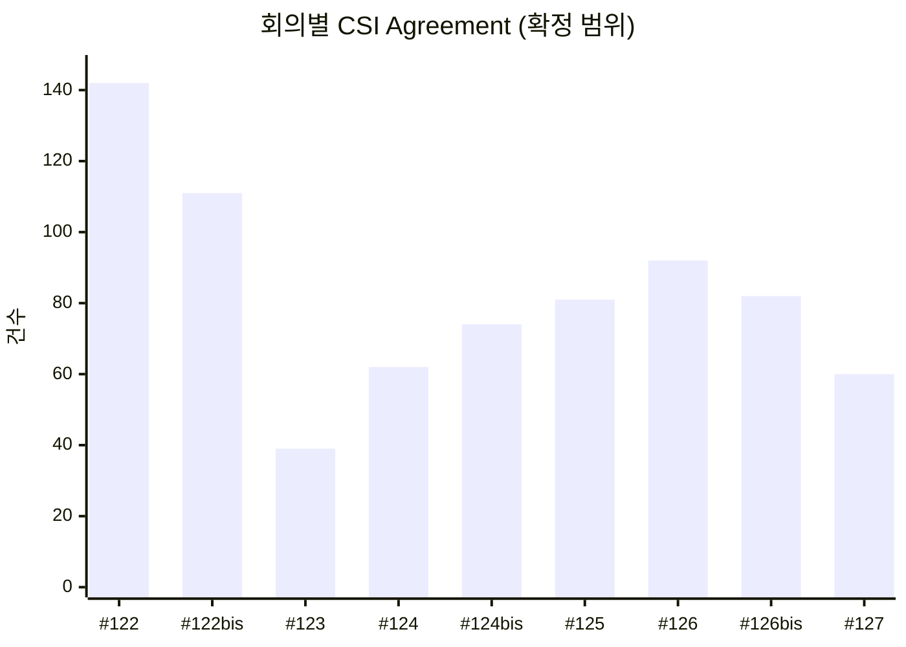

# RAN1 CSI 결정 대시보드

> 원본 DB 마지막 업데이트 **2026-11-21 13:17 KST** · 범위 RAN1#122 – #127 (9회) · [HTML 대시보드](https://jgunmoon.github.io/RAN1-CSI-Dashboard/) · 원본 [jgunmoon/RAN1-Decision-Tracker](https://github.com/jgunmoon/RAN1-Decision-Tracker)

> ⚠️ **Agenda 확인 필요 (RAN1#126bis → RAN1#127)** — 결정이 범위에서 조용히 빠지지 않도록 확인하세요.
>
> - 포함 Agenda **CSI acquisition and report: Other aspects (TRS, DL+UL 결합 CSI 등)** (Rel-20 Study of 6GR): RAN1#126bis에 12건 → RAN1#127에 없음. 제목·섹션이 바뀌었으면 `config/csi_scope.yaml`의 agendas를 고칩니다.
> - 포함 Agenda **Maintenance on AI/ML·MIMO Ph5·NES·NTN (CSI 키워드·조항 있는 결정만)** (Maintenance on Rel-19 NR and E-UTRA): RAN1#126bis에 2건 → RAN1#127에 없음. 제목·섹션이 바뀌었으면 `config/csi_scope.yaml`의 agendas를 고칩니다.
> - 새 Agenda **9.6 Rel-20 UE features** (Release 20 NR): 확정 0 · 후보 14 / 전체 21건. CSI Agenda면 agendas에 넣습니다.
> - 새 Agenda **8.1 Maintenance on all items of Rel-19 NR and E-UTRA** (Maintenance on Rel-19 NR and E-UTRA): 확정 0 · 후보 7 / 전체 16건. CSI Agenda면 agendas에 넣습니다.
>
> 확인했고 CSI와 무관하면 `acknowledged_alerts`에 아래 키를 넣으면 경고가 사라집니다: `RAN1#127: CSI acquisition and report: Other aspects (TRS, DL+UL 결합 CSI 등)`, `RAN1#127: Maintenance on AI/ML·MIMO Ph5·NES·NTN (CSI 키워드·조항 있는 결정만)`, `RAN1#127: Release 20 NR > Rel-20 UE features`, `RAN1#127: Maintenance on Rel-19 NR and E-UTRA > Maintenance on all items of Rel-19 NR and E-UTRA`

3GPP RAN1 Chair notes의 결정 중 CSI 관련(CSI 획득·보고, CSI-RS, codebook, beam management, SRS, AI/ML CSI)만 모았습니다.
범위·주제 규칙은 [`config/csi_scope.yaml`](../config/csi_scope.yaml)에 있습니다. 이 파일은 자동 생성물이므로 직접 고치지 않습니다.

| 구분 | 건수 |
|---|---:|
| 확정 (포함 Agenda + 수동 포함) | **805** (Agreement 743 · WA 5 · Conclusion 57) |
| 후보 (다른 Agenda의 키워드 일치, 확인 필요) | 243 |

## 직전 회의 대비 (RAN1#126bis → RAN1#127)

확정 범위의 Agreement 수입니다. RAN1#127의 결정은 모두 이번 회의의 신규 결정입니다.

| 주제 | #126bis | **#127** | 증감 |
|---|---:|---:|---:|
| [AI/ML CSI](by_topic/aiml.md) | 7 | **10** | +3 |
| [SRS](by_topic/srs.md) | 24 | **16** | -8 |
| [Beam management](by_topic/beam.md) | 18 | **13** | -5 |
| [CSI 보고/codebook](by_topic/report.md) | 17 | **13** | -4 |
| [CSI-RS](by_topic/csirs.md) | 5 | **5** | +0 |
| [기타 CSI](by_topic/other.md) | 11 | **3** | -8 |
| **합계** | 82 | **60** | -22 |

## 주제별 · 회의별 Agreement

확정 범위의 Agreement만 셉니다. Working Assumption·Conclusion과 후보는 HTML 대시보드에서 체크박스로 켤 수 있습니다.
회의별 숫자는 결정마다 하나인 **주된 주제**로 셉니다. 한 결정이 여러 주제에 걸치면 나머지는 **관련 주제**로 붙고,
맨 끝 '관련 포함' 열은 관련 주제까지 센 전체 회의 합계라 합계가 전체 건수보다 큽니다.

| 주된 주제 | #122 | #122bis | #123 | #124 | #124bis | #125 | #126 | #126bis | #127 | 합계 | 관련 포함 |
|---|---:|---:|---:|---:|---:|---:|---:|---:|---:|---:|---:|
| [AI/ML CSI](by_topic/aiml.md) | 58 | 43 | 15 | 17 | 15 | 13 | 10 | 7 | 10 | **188** | 202 |
| [SRS](by_topic/srs.md) | 28 | 16 | 9 | 17 | 25 | 21 | 26 | 24 | 16 | **182** | 194 |
| [Beam management](by_topic/beam.md) | 15 | 3 | 3 | 15 | 11 | 22 | 31 | 18 | 13 | **131** | 152 |
| [CSI 보고/codebook](by_topic/report.md) | 21 | 33 | 5 | 8 | 14 | 14 | 13 | 17 | 13 | **138** | 396 |
| [CSI-RS](by_topic/csirs.md) | 4 | 1 | 1 | 4 | 8 | 9 | 9 | 5 | 5 | **46** | 202 |
| [기타 CSI](by_topic/other.md) | 16 | 15 | 6 | 1 | 1 | 2 | 3 | 11 | 3 | **58** | 58 |
| **합계** | **142** | **111** | **39** | **62** | **74** | **81** | **92** | **82** | **60** | **743** | — |

## 포함 Agenda별 · 회의별 Agreement

Agenda 번호는 회의마다 바뀌므로 '섹션 + Agenda 제목'으로 이어 붙였습니다. 괄호 안 번호는 가장 최근 회의 번호입니다.

| Agenda | #122 | #122bis | #123 | #124 | #124bis | #125 | #126 | #126bis | #127 | 합계 |
|---|---:|---:|---:|---:|---:|---:|---:|---:|---:|---:|
| Aspects of downlink-based CSI acquisition (Rel-20 Study of 6GR, 최근 10.5.3.1) | · | · | · | 5 | 17 | 18 | 20 | 21 | 17 | **98** |
| Aspects of uplink-based CSI acquisition (Rel-20 Study of 6GR, 최근 10.5.3.2) | · | · | · | 5 | 14 | 9 | 7 | 12 | 10 | **57** |
| Beam management for downlink and uplink (Rel-20 Study of 6GR, 최근 10.5.3.4) | · | · | · | 4 | 9 | 13 | 12 | 9 | 6 | **53** |
| Synchronization acquisition and beam measurement (Rel-20 Study of 6GR, 최근 10.5.1.1) | · | · | · | 6 | 1 | 8 | 15 | 8 | 7 | **45** |
| CSI acquisition and report: Other aspects (TRS, DL+UL 결합 CSI 등) (Rel-20 Study of 6GR, 최근 10.5.3.3) | · | · | · | 5 | 9 | 5 | 8 | 12 | · | **39** |
| NR MIMO Phase 6 (상위 Agenda) (Release 20 NR, 최근 9.2) | · | · | · | · | 7 | 14 | 15 | 12 | 10 | **58** |
| Enhancing DL CSI acquisition (Release 20 NR, 최근 9.2.2) | 8 | 12 | 5 | 9 | · | · | · | · | · | **34** |
| Improvement of SRS capacity and coverage (Release 20 NR, 최근 9.2.1) | 7 | 7 | 8 | 5 | · | · | · | · | · | **27** |
| AI/ML CSI compression Case 0 (Inference related aspects 등 하위 포함) (Release 20 NR, 최근 9.1.1) | 10 | 10 | 9 | 5 | 5 | 4 | 4 | 4 | 7 | **58** |
| Inter-vendor training collaboration for two-sided AI/ML models (Release 20 NR, 최근 9.1.2) | 5 | 2 | 2 | 4 | 3 | 5 | 4 | 2 | 3 | **30** |
| UE features for NR MIMO Phase N (Rel-19 UE Features, 최근 9.2) | 49 | 31 | · | · | · | · | · | · | · | **80** |
| Maintenance on NR MIMO Phase N (하위 포함) (Maintenance on Rel-19 NR and E-UTRA, 최근 8.2) | 20 | 18 | 11 | 8 | 7 | · | · | · | · | **64** |
| UE features for AI/ML (positioning 제외) (Rel-19 UE Features, 최근 9.1) | 19 | 18 | · | · | · | · | · | · | · | **37** |
| Maintenance on AI/ML (positioning 제외) (Maintenance on Rel-19 NR and E-UTRA, 최근 8.1) | 3 | 13 | 4 | 6 | 2 | · | · | · | · | **28** |
| Maintenance on AI/ML·MIMO Ph5·NES·NTN (CSI 키워드·조항 있는 결정만) (Maintenance on Rel-19 NR and E-UTRA, 최근 8.1) | · | · | · | · | · | 5 | 7 | 2 | · | **14** |
| AI/ML: Specification support for beam management (Maintenance on Rel-19 NR and E-UTRA, 최근 8.1.1) | 12 | · | · | · | · | · | · | · | · | **12** |
| AI/ML: Specification support for CSI prediction (Maintenance on Rel-19 NR and E-UTRA, 최근 8.1.3) | 9 | · | · | · | · | · | · | · | · | **9** |
| **합계** | **142** | **111** | **39** | **62** | **74** | **81** | **92** | **82** | **60** | **743** |

## RAN1#127 신규 CSI Agreement (60건)

아래 문장은 요약이 아니라 **원문 첫 줄**입니다(길면 자름). 전체 원문은 주제별 리포트와 HTML 대시보드에 있습니다.

| 주제 | Agenda | 원문 첫 줄 | 출처 |
|---|---|---|---|
| AI/ML CSI | 9.1.1 CSI spatial/frequency compression without temporal aspects (“Case 0”) | For L1 performance monitoring, support UE indication of monitoring output with 1-bit reliability indicator | [Chair notes RAN1#127_eom1](https://www.3gpp.org/ftp/Meetings_3GPP_SYNC/RAN1/Inbox/Chair_notes/Chair%20notes%20RAN1%23127_eom1.docx) |
| AI/ML CSI | 9.1.1 CSI spatial/frequency compression without temporal aspects (“Case 0”) | For L1 performance monitoring and the reliability indication, support | [Chair notes RAN1#127_eom1](https://www.3gpp.org/ftp/Meetings_3GPP_SYNC/RAN1/Inbox/Chair_notes/Chair%20notes%20RAN1%23127_eom1.docx) |
| AI/ML CSI | 9.1.1 CSI spatial/frequency compression without temporal aspects (“Case 0”) | For CSI feedback via two-sided model, clarify that neither CRI nor LI is reported. UE is not expected to be c… | [Chair notes RAN1#127_eom1](https://www.3gpp.org/ftp/Meetings_3GPP_SYNC/RAN1/Inbox/Chair_notes/Chair%20notes%20RAN1%23127_eom1.docx) |
| AI/ML CSI | 9.1.1 CSI spatial/frequency compression without temporal aspects (“Case 0”) | For UE side data collection for CSI feedback via two-sided model, reuse the CPU duration agreed for Rel-19 CS… | [Chair notes RAN1#127_eom1](https://www.3gpp.org/ftp/Meetings_3GPP_SYNC/RAN1/Inbox/Chair_notes/Chair%20notes%20RAN1%23127_eom1.docx) |
| AI/ML CSI | 9.1.1 CSI spatial/frequency compression without temporal aspects (“Case 0”) | Regarding incoming LS R2-2608003 on L3 performance monitoring, reply to RAN2 that | [Chair notes RAN1#127_eom1](https://www.3gpp.org/ftp/Meetings_3GPP_SYNC/RAN1/Inbox/Chair_notes/Chair%20notes%20RAN1%23127_eom1.docx) |
| AI/ML CSI | 9.1.1 CSI spatial/frequency compression without temporal aspects (“Case 0”) | For L1 performance monitoring, support UE indication of monitoring output with 1-bit reliability indicator | [Chair notes RAN1#127_eom1](https://www.3gpp.org/ftp/Meetings_3GPP_SYNC/RAN1/Inbox/Chair_notes/Chair%20notes%20RAN1%23127_eom1.docx) |
| AI/ML CSI | 9.1.1 CSI spatial/frequency compression without temporal aspects (“Case 0”) | For L1 performance monitoring and the reliability indication, support | [Chair notes RAN1#127_eom1](https://www.3gpp.org/ftp/Meetings_3GPP_SYNC/RAN1/Inbox/Chair_notes/Chair%20notes%20RAN1%23127_eom1.docx) |
| AI/ML CSI | 9.1.2 Inter-vendor training collaboration for two-sided AI/ML models | For model applicability procedure for inference with Option B, the following inference related parameters are… | [Chair notes RAN1#127_eom1](https://www.3gpp.org/ftp/Meetings_3GPP_SYNC/RAN1/Inbox/Chair_notes/Chair%20notes%20RAN1%23127_eom1.docx) |
| AI/ML CSI | 9.1.2 Inter-vendor training collaboration for two-sided AI/ML models | For the model pairing procedure for AI/ML based CSI compression, | [Chair notes RAN1#127_eom1](https://www.3gpp.org/ftp/Meetings_3GPP_SYNC/RAN1/Inbox/Chair_notes/Chair%20notes%20RAN1%23127_eom1.docx) · [R1-2609843](https://www.3gpp.org/ftp/tsg_ran/WG1_RL1/TSGR1_127/Docs/R1-2609843.zip) |
| AI/ML CSI | 9.1.2 Inter-vendor training collaboration for two-sided AI/ML models | Regarding the LS from RAN2 in R1-2603496, the draft LS response in R1-2610935 is endorsed with the following … | [Chair notes RAN1#127_eom1](https://www.3gpp.org/ftp/Meetings_3GPP_SYNC/RAN1/Inbox/Chair_notes/Chair%20notes%20RAN1%23127_eom1.docx) · [R1-2609843](https://www.3gpp.org/ftp/tsg_ran/WG1_RL1/TSGR1_127/Docs/R1-2609843.zip) |
| CSI 보고/codebook | 9.2 NR MIMO Phase 6 | On how to indicate the slot offset of PUSCH for aperiodic CSI reporting triggered by a SCell activation comma… | [Chair notes RAN1#127_eom1](https://www.3gpp.org/ftp/Meetings_3GPP_SYNC/RAN1/Inbox/Chair_notes/Chair%20notes%20RAN1%23127_eom1.docx) · [R1-2609214](https://www.3gpp.org/ftp/tsg_ran/WG1_RL1/TSGR1_127/Docs/R1-2609214.zip) · `[127-R20-MIMO]` |
| SRS | 9.2 NR MIMO Phase 6 | For a UE transition from IDLE/INACTIVE to CONNECT mode on the SUL, aperiodic SRS-AS triggered by MAC-CE in th… | [Chair notes RAN1#127_eom1](https://www.3gpp.org/ftp/Meetings_3GPP_SYNC/RAN1/Inbox/Chair_notes/Chair%20notes%20RAN1%23127_eom1.docx) · [R1-2609214](https://www.3gpp.org/ftp/tsg_ran/WG1_RL1/TSGR1_127/Docs/R1-2609214.zip) · `[127-R20-MIMO]` |
| CSI 보고/codebook | 9.2 NR MIMO Phase 6 | For MSG4-triggered aperiodic TRS with two TRS bursts, the second TRS burst is transmitted in the slot which i… | [Chair notes RAN1#127_eom1](https://www.3gpp.org/ftp/Meetings_3GPP_SYNC/RAN1/Inbox/Chair_notes/Chair%20notes%20RAN1%23127_eom1.docx) · [R1-2609214](https://www.3gpp.org/ftp/tsg_ran/WG1_RL1/TSGR1_127/Docs/R1-2609214.zip) · `[127-R20-MIMO]` |
| SRS | 9.2 NR MIMO Phase 6 | Support close-loop power control (CLPC) for MSG4-triggered SRS when UE transition from IDLE/INACTIVE to CONNE… | [Chair notes RAN1#127_eom1](https://www.3gpp.org/ftp/Meetings_3GPP_SYNC/RAN1/Inbox/Chair_notes/Chair%20notes%20RAN1%23127_eom1.docx) · [R1-2609214](https://www.3gpp.org/ftp/tsg_ran/WG1_RL1/TSGR1_127/Docs/R1-2609214.zip) · `[127-R20-MIMO]` |
| 기타 CSI | 9.2 NR MIMO Phase 6 | Support close-loop power control (CLPC) for MSG4-scheduled PUSCH when UE transition from IDLE/INACTIVE to CON… | [Chair notes RAN1#127_eom1](https://www.3gpp.org/ftp/Meetings_3GPP_SYNC/RAN1/Inbox/Chair_notes/Chair%20notes%20RAN1%23127_eom1.docx) · [R1-2609214](https://www.3gpp.org/ftp/tsg_ran/WG1_RL1/TSGR1_127/Docs/R1-2609214.zip) · `[127-R20-MIMO]` |
| CSI 보고/codebook | 9.2 NR MIMO Phase 6 | On triggering indication for early CSI reporting and associated aperiodic CSI-RS triggered by a SCell activat… | [Chair notes RAN1#127_eom1](https://www.3gpp.org/ftp/Meetings_3GPP_SYNC/RAN1/Inbox/Chair_notes/Chair%20notes%20RAN1%23127_eom1.docx) · [R1-2609215](https://www.3gpp.org/ftp/tsg_ran/WG1_RL1/TSGR1_127/Docs/R1-2609215.zip) · `[127-R20-MIMO]` |
| SRS | 9.2 NR MIMO Phase 6 | On MAC-CE triggering indication for early SRS based on a SCell activation command, the SCell activation comma… | [Chair notes RAN1#127_eom1](https://www.3gpp.org/ftp/Meetings_3GPP_SYNC/RAN1/Inbox/Chair_notes/Chair%20notes%20RAN1%23127_eom1.docx) · [R1-2609216](https://www.3gpp.org/ftp/tsg_ran/WG1_RL1/TSGR1_127/Docs/R1-2609216.zip) · `[127-R20-MIMO]` |
| SRS | 9.2 NR MIMO Phase 6 | In a SIBx for early CSI-RS/SRS/CSI when UE transition from IDLE/INACTIVE to CONNECTED mode, support the follo… | [Chair notes RAN1#127_eom1](https://www.3gpp.org/ftp/Meetings_3GPP_SYNC/RAN1/Inbox/Chair_notes/Chair%20notes%20RAN1%23127_eom1.docx) · [R1-2609216](https://www.3gpp.org/ftp/tsg_ran/WG1_RL1/TSGR1_127/Docs/R1-2609216.zip) · `[127-R20-MIMO]` |
| SRS | 9.2 NR MIMO Phase 6 | Regarding the RPFS start RB index hopping across multiple legacy SRS frequency hopping periods determined by … | [Chair notes RAN1#127_eom1](https://www.3gpp.org/ftp/Meetings_3GPP_SYNC/RAN1/Inbox/Chair_notes/Chair%20notes%20RAN1%23127_eom1.docx) · [R1-2609659](https://www.3gpp.org/ftp/tsg_ran/WG1_RL1/TSGR1_127/Docs/R1-2609659.zip) · `[127-R20-MIMO]` |
| SRS | 9.2 NR MIMO Phase 6 | Regarding the configuration of KF, PF and K, down-select one from the following alternatives | [Chair notes RAN1#127_eom1](https://www.3gpp.org/ftp/Meetings_3GPP_SYNC/RAN1/Inbox/Chair_notes/Chair%20notes%20RAN1%23127_eom1.docx) · [R1-2609659](https://www.3gpp.org/ftp/tsg_ran/WG1_RL1/TSGR1_127/Docs/R1-2609659.zip) · `[127-R20-MIMO]` |
| Beam management | 10.5.1.1 Synchronization acquisition and beam measurement | For 6GR PSS, | [Chair notes RAN1#127_eom1](https://www.3gpp.org/ftp/Meetings_3GPP_SYNC/RAN1/Inbox/Chair_notes/Chair%20notes%20RAN1%23127_eom1.docx) · `[127-R20-6GR-Synchronization and Beam Measurement]` |
| Beam management | 10.5.1.1 Synchronization acquisition and beam measurement | For 6GR SSS | [Chair notes RAN1#127_eom1](https://www.3gpp.org/ftp/Meetings_3GPP_SYNC/RAN1/Inbox/Chair_notes/Chair%20notes%20RAN1%23127_eom1.docx) · `[127-R20-6GR-Synchronization and Beam Measurement]` |
| Beam management | 10.5.1.1 Synchronization acquisition and beam measurement | For SSB design, downselect one from Alt 1 and Alt 2, | [Chair notes RAN1#127_eom1](https://www.3gpp.org/ftp/Meetings_3GPP_SYNC/RAN1/Inbox/Chair_notes/Chair%20notes%20RAN1%23127_eom1.docx) · `[127-R20-6GR-Synchronization and Beam Measurement]` |
| Beam management | 10.5.1.1 Synchronization acquisition and beam measurement | The coverage gaps relative to the basic coverage of 143 dB MaxCL and extended coverage of 153 dB MaxCL for di… | [Chair notes RAN1#127_eom1](https://www.3gpp.org/ftp/Meetings_3GPP_SYNC/RAN1/Inbox/Chair_notes/Chair%20notes%20RAN1%23127_eom1.docx) · `[127-R20-6GR-Synchronization and Beam Measurement]` |
| Beam management | 10.5.1.1 Synchronization acquisition and beam measurement | For the extended coverage of 153 dB MaxCL in TR 38.914, study how to meet the requirement with relaxed perfor… | [Chair notes RAN1#127_eom1](https://www.3gpp.org/ftp/Meetings_3GPP_SYNC/RAN1/Inbox/Chair_notes/Chair%20notes%20RAN1%23127_eom1.docx) · `[127-R20-6GR-Synchronization and Beam Measurement]` |
| Beam management | 10.5.1.1 Synchronization acquisition and beam measurement | - For UEs in connected mode, additional transmission of synchronization signal(s)/reference signals in additi… | [Chair notes RAN1#127_eom1](https://www.3gpp.org/ftp/Meetings_3GPP_SYNC/RAN1/Inbox/Chair_notes/Chair%20notes%20RAN1%23127_eom1.docx) · `[127-R20-6GR-Synchronization and Beam Measurement]` |
| Beam management | 10.5.1.1 Synchronization acquisition and beam measurement | Study FDMed paging, where the paging occasions/messages are multiplexed in frequency domain, to facilitate ne… | [Chair notes RAN1#127_eom1](https://www.3gpp.org/ftp/Meetings_3GPP_SYNC/RAN1/Inbox/Chair_notes/Chair%20notes%20RAN1%23127_eom1.docx) · `[127-R20-6GR-Synchronization and Beam Measurement]` |
| CSI 보고/codebook | 10.5.3.1 Aspects of downlink-based CSI acquisition | - For NW-triggered CSI reporting, support Aperiodic CSI reporting on PUSCH for both wideband and subband CSI … | [Chair notes RAN1#127_eom1](https://www.3gpp.org/ftp/Meetings_3GPP_SYNC/RAN1/Inbox/Chair_notes/Chair%20notes%20RAN1%23127_eom1.docx) · `[127-R20-6GR-Aspects of DL based CSI acquisition]` |
| CSI-RS | 10.5.3.1 Aspects of downlink-based CSI acquisition | For 6GR, the maximum number of CSI-RS ports is 256 | [Chair notes RAN1#127_eom1](https://www.3gpp.org/ftp/Meetings_3GPP_SYNC/RAN1/Inbox/Chair_notes/Chair%20notes%20RAN1%23127_eom1.docx) · `[127-R20-6GR-Aspects of DL based CSI acquisition]` |
| CSI 보고/codebook | 10.5.3.1 Aspects of downlink-based CSI acquisition | For the 6GR codebook design for CSI report, for sTRP, targeting different use cases, support W1W2 structure b… | [Chair notes RAN1#127_eom1](https://www.3gpp.org/ftp/Meetings_3GPP_SYNC/RAN1/Inbox/Chair_notes/Chair%20notes%20RAN1%23127_eom1.docx) · `[127-R20-6GR-Aspects of DL based CSI acquisition]` |
| CSI 보고/codebook | 10.5.3.1 Aspects of downlink-based CSI acquisition | For the 6GR codebook design for CSI report, for CJT, RAN 1 recommends to support at least one of the W1W2 str… | [Chair notes RAN1#127_eom1](https://www.3gpp.org/ftp/Meetings_3GPP_SYNC/RAN1/Inbox/Chair_notes/Chair%20notes%20RAN1%23127_eom1.docx) · `[127-R20-6GR-Aspects of DL based CSI acquisition]` |
| CSI 보고/codebook | 10.5.3.1 Aspects of downlink-based CSI acquisition | - For UE-assisted report for the 6GR DL based CSI, to facilitate CJT deployments, RAN 1 recommends to support… | [Chair notes RAN1#127_eom1](https://www.3gpp.org/ftp/Meetings_3GPP_SYNC/RAN1/Inbox/Chair_notes/Chair%20notes%20RAN1%23127_eom1.docx) · `[127-R20-6GR-Aspects of DL based CSI acquisition]` |
| CSI 보고/codebook | 10.5.3.1 Aspects of downlink-based CSI acquisition | For UE-assisted report for the 6GR DL based CSI, RAN 1 recommends to support Channel Property Information (CP… | [Chair notes RAN1#127_eom1](https://www.3gpp.org/ftp/Meetings_3GPP_SYNC/RAN1/Inbox/Chair_notes/Chair%20notes%20RAN1%23127_eom1.docx) · `[127-R20-6GR-Aspects of DL based CSI acquisition]` |
| CSI-RS | 10.5.3.1 Aspects of downlink-based CSI acquisition | 6GR CSI-RS supports the following numbers of ports: 1, 2, 4, 8, 12, 16, 24, 32, 48, 64, 128, 256 | [Chair notes RAN1#127_eom1](https://www.3gpp.org/ftp/Meetings_3GPP_SYNC/RAN1/Inbox/Chair_notes/Chair%20notes%20RAN1%23127_eom1.docx) · `[127-R20-6GR-Aspects of DL based CSI acquisition]` |
| CSI-RS | 10.5.3.1 Aspects of downlink-based CSI acquisition | For 6GR CSI-RS CDM size and type, prioritize the following candidates for further down-selection per port num… | [Chair notes RAN1#127_eom1](https://www.3gpp.org/ftp/Meetings_3GPP_SYNC/RAN1/Inbox/Chair_notes/Chair%20notes%20RAN1%23127_eom1.docx) · `[127-R20-6GR-Aspects of DL based CSI acquisition]` |
| CSI-RS | 10.5.3.1 Aspects of downlink-based CSI acquisition | For 6GR CSI-RS, on the study of options to address the potential inter-cell interference issue caused by NR C… | [Chair notes RAN1#127_eom1](https://www.3gpp.org/ftp/Meetings_3GPP_SYNC/RAN1/Inbox/Chair_notes/Chair%20notes%20RAN1%23127_eom1.docx) · `[127-R20-6GR-Aspects of DL based CSI acquisition]` |
| CSI-RS | 10.5.3.1 Aspects of downlink-based CSI acquisition | On the locations of M2 RBs in each RB set for 6GR CSI-RS, support | [Chair notes RAN1#127_eom1](https://www.3gpp.org/ftp/Meetings_3GPP_SYNC/RAN1/Inbox/Chair_notes/Chair%20notes%20RAN1%23127_eom1.docx) · `[127-R20-6GR-Aspects of DL based CSI acquisition]` |
| 기타 CSI | 10.5.3.1 Aspects of downlink-based CSI acquisition | For the supported W1W2Wf structure based schemes, for the FD basis design, support at least NR DFT FD basis d… | [Chair notes RAN1#127_eom1](https://www.3gpp.org/ftp/Meetings_3GPP_SYNC/RAN1/Inbox/Chair_notes/Chair%20notes%20RAN1%23127_eom1.docx) · `[127-R20-6GR-Aspects of DL based CSI acquisition]` |
| CSI 보고/codebook | 10.5.3.1 Aspects of downlink-based CSI acquisition | On CSI reporting based on a received PDSCH DMRS, decide by RAN 1 #128, whether or not to support the followin… | [Chair notes RAN1#127_eom1](https://www.3gpp.org/ftp/Meetings_3GPP_SYNC/RAN1/Inbox/Chair_notes/Chair%20notes%20RAN1%23127_eom1.docx) · `[127-R20-6GR-Aspects of DL based CSI acquisition]` |
| CSI 보고/codebook | 10.5.3.1 Aspects of downlink-based CSI acquisition | Draft Reply LS R1-2610976 on JSCM-based CSI compression with AI is endorsed in principle. | [Chair notes RAN1#127_eom1](https://www.3gpp.org/ftp/Meetings_3GPP_SYNC/RAN1/Inbox/Chair_notes/Chair%20notes%20RAN1%23127_eom1.docx) · `[127-R20-6GR-Aspects of DL based CSI acquisition]` |
| CSI 보고/codebook | 10.5.3.1 Aspects of downlink-based CSI acquisition | Final Reply LS R1-2610977 on JSCM-based CSI compression with AI is endorsed. | [Chair notes RAN1#127_eom1](https://www.3gpp.org/ftp/Meetings_3GPP_SYNC/RAN1/Inbox/Chair_notes/Chair%20notes%20RAN1%23127_eom1.docx) · `[127-R20-6GR-Aspects of DL based CSI acquisition]` |
| CSI 보고/codebook | 10.5.3.1 Aspects of downlink-based CSI acquisition | To assess whether specification enhancement is needed for SD-precoded CSI-RS, | [Chair notes RAN1#127_eom1](https://www.3gpp.org/ftp/Meetings_3GPP_SYNC/RAN1/Inbox/Chair_notes/Chair%20notes%20RAN1%23127_eom1.docx) · `[127-R20-6GR-Aspects of DL based CSI acquisition]` |
| 기타 CSI | 10.5.3.1 Aspects of downlink-based CSI acquisition | Draft LS R1-2610974 on UE channel property information reporting is endorsed in principle. | [Chair notes RAN1#127_eom1](https://www.3gpp.org/ftp/Meetings_3GPP_SYNC/RAN1/Inbox/Chair_notes/Chair%20notes%20RAN1%23127_eom1.docx) · `[127-R20-6GR-Aspects of DL based CSI acquisition]` |
| CSI 보고/codebook | 10.5.3.1 Aspects of downlink-based CSI acquisition | Final LS R1-2610975 on UE channel property information reporting is endorsed. | [Chair notes RAN1#127_eom1](https://www.3gpp.org/ftp/Meetings_3GPP_SYNC/RAN1/Inbox/Chair_notes/Chair%20notes%20RAN1%23127_eom1.docx) · `[127-R20-6GR-Aspects of DL based CSI acquisition]` |
| SRS | 10.5.3.2 Aspects of uplink-based CSI acquisition | Support at least the following combinations of comb value and cyclic shift for comb values less than or equal… | [Chair notes RAN1#127_eom1](https://www.3gpp.org/ftp/Meetings_3GPP_SYNC/RAN1/Inbox/Chair_notes/Chair%20notes%20RAN1%23127_eom1.docx) · `[127-R20-6GR-Aspects of UL based CSI acquisition]` |
| SRS | 10.5.3.2 Aspects of uplink-based CSI acquisition | Support SRS repetition in 6GR. | [Chair notes RAN1#127_eom1](https://www.3gpp.org/ftp/Meetings_3GPP_SYNC/RAN1/Inbox/Chair_notes/Chair%20notes%20RAN1%23127_eom1.docx) · `[127-R20-6GR-Aspects of UL based CSI acquisition]` |
| SRS | 10.5.3.2 Aspects of uplink-based CSI acquisition | For DL CBW larger than 200MHz, for sounding of all parts of the target bandwidth over multiple transmissions … | [Chair notes RAN1#127_eom1](https://www.3gpp.org/ftp/Meetings_3GPP_SYNC/RAN1/Inbox/Chair_notes/Chair%20notes%20RAN1%23127_eom1.docx) · `[127-R20-6GR-Aspects of UL based CSI acquisition]` |
| SRS | 10.5.3.2 Aspects of uplink-based CSI acquisition | Support at least the following case of sharing one SRS transmission occasion for multiple usages: | [Chair notes RAN1#127_eom1](https://www.3gpp.org/ftp/Meetings_3GPP_SYNC/RAN1/Inbox/Chair_notes/Chair%20notes%20RAN1%23127_eom1.docx) · `[127-R20-6GR-Aspects of UL based CSI acquisition]` |
| SRS | 10.5.3.2 Aspects of uplink-based CSI acquisition | For 6GR, support at least the following interference randomization mechanisms | [Chair notes RAN1#127_eom1](https://www.3gpp.org/ftp/Meetings_3GPP_SYNC/RAN1/Inbox/Chair_notes/Chair%20notes%20RAN1%23127_eom1.docx) · `[127-R20-6GR-Aspects of UL based CSI acquisition]` |
| SRS | 10.5.3.2 Aspects of uplink-based CSI acquisition | Support dynamic adaptation (other than RRC configuration) of at least one of the following parameters of SRS: | [Chair notes RAN1#127_eom1](https://www.3gpp.org/ftp/Meetings_3GPP_SYNC/RAN1/Inbox/Chair_notes/Chair%20notes%20RAN1%23127_eom1.docx) · `[127-R20-6GR-Aspects of UL based CSI acquisition]` |
| SRS | 10.5.3.2 Aspects of uplink-based CSI acquisition | For 2-level SRS frequency hopping patterns for 6GR, support the following pattern within frequency hopping pe… | [Chair notes RAN1#127_eom1](https://www.3gpp.org/ftp/Meetings_3GPP_SYNC/RAN1/Inbox/Chair_notes/Chair%20notes%20RAN1%23127_eom1.docx) · `[127-R20-6GR-Aspects of UL based CSI acquisition]` |
| SRS | 10.5.3.2 Aspects of uplink-based CSI acquisition | For 6GR SRS, support start RB hopping across different frequency hopping periods. | [Chair notes RAN1#127_eom1](https://www.3gpp.org/ftp/Meetings_3GPP_SYNC/RAN1/Inbox/Chair_notes/Chair%20notes%20RAN1%23127_eom1.docx) · `[127-R20-6GR-Aspects of UL based CSI acquisition]` |
| SRS | 10.5.3.2 Aspects of uplink-based CSI acquisition | Send an LS to RAN4 to clarify the UE RF retuning/switching timeline and requirement when switching SRS betwee… | [Chair notes RAN1#127_eom1](https://www.3gpp.org/ftp/Meetings_3GPP_SYNC/RAN1/Inbox/Chair_notes/Chair%20notes%20RAN1%23127_eom1.docx) · `[127-R20-6GR-Aspects of UL based CSI acquisition]` |
| SRS | 10.5.3.2 Aspects of uplink-based CSI acquisition | Consider computer-generated SRS sequences for lengths < M, and down-select one option for the value of M: | [Chair notes RAN1#127_eom1](https://www.3gpp.org/ftp/Meetings_3GPP_SYNC/RAN1/Inbox/Chair_notes/Chair%20notes%20RAN1%23127_eom1.docx) · `[127-R20-6GR-Aspects of UL based CSI acquisition]` |
| Beam management | 10.5.3.4 Beam management for downlink and uplink | At least for FR2, study UE UL beam sweeping for 6GR targeting at least Asymmetric DL sTRP and UL mTRP. | [Chair notes RAN1#127_eom1](https://www.3gpp.org/ftp/Meetings_3GPP_SYNC/RAN1/Inbox/Chair_notes/Chair%20notes%20RAN1%23127_eom1.docx) · `[127-R20-6GR-Beam management]` |
| Beam management | 10.5.3.4 Beam management for downlink and uplink | - Study the procedure of NW initiated UL beam sweeping considering, at least for FR2 | [Chair notes RAN1#127_eom1](https://www.3gpp.org/ftp/Meetings_3GPP_SYNC/RAN1/Inbox/Chair_notes/Chair%20notes%20RAN1%23127_eom1.docx) · `[127-R20-6GR-Beam management]` |
| Beam management | 10.5.3.4 Beam management for downlink and uplink | For RAN4 LS on 6G FR2 UE digital beamforming architecture [R1-2609011/R4-2621663]: | [Chair notes RAN1#127_eom1](https://www.3gpp.org/ftp/Meetings_3GPP_SYNC/RAN1/Inbox/Chair_notes/Chair%20notes%20RAN1%23127_eom1.docx) · `[127-R20-6GR-Beam management]` |
| Beam management | 10.5.3.4 Beam management for downlink and uplink | With respect to RAN4 LS in R1-2609011(R4-2621663), the draft reply LS in R1-2610994 is endorsed in principle. | [Chair notes RAN1#127_eom1](https://www.3gpp.org/ftp/Meetings_3GPP_SYNC/RAN1/Inbox/Chair_notes/Chair%20notes%20RAN1%23127_eom1.docx) · `[127-R20-6GR-Beam management]` |
| Beam management | 10.5.3.4 Beam management for downlink and uplink | Final reply LS in R1-2610995 is endorsed. | [Chair notes RAN1#127_eom1](https://www.3gpp.org/ftp/Meetings_3GPP_SYNC/RAN1/Inbox/Chair_notes/Chair%20notes%20RAN1%23127_eom1.docx) · `[127-R20-6GR-Beam management]` |
| Beam management | 10.5.3.4 Beam management for downlink and uplink | Regarding DL beam measurement and report procedure, for the study on L1-SINR based DL beam measurement and re… | [Chair notes RAN1#127_eom1](https://www.3gpp.org/ftp/Meetings_3GPP_SYNC/RAN1/Inbox/Chair_notes/Chair%20notes%20RAN1%23127_eom1.docx) · `[127-R20-6GR-Beam management]` |

## 최근 변경 이력

실행마다 직전 결과와 비교한 기록입니다. 새 회의 결정은 '신규'로 보이지만, 원본이 **과거 회의**를 다시 처리해 생긴
추가·변경·삭제(파서 개선, 잠정 → 종료본 교체 등)는 여기서만 알 수 있습니다. 전체 기록은 `changes.json`에 있습니다.

| 시각 (UTC) | 이유 | 새 회의 | 기존 회의 추가 | 변경 | 삭제 |
|---|---|---|---:|---:|---:|
| 2026-11-21 08:21 | 원본 회의록 갱신 | — | 71 | 1 | 0 |
| 2026-11-20 08:37 | 원본 회의록 갱신 | — | 12 | 2 | 0 |
| 2026-11-19 08:51 | 원본 회의록 갱신 | — | 8 | 0 | 0 |
| 2026-11-18 08:36 | 원본 회의록 갱신 | RAN1#127 14건 | 0 | 0 | 0 |
| 2026-10-20 08:01 | 대시보드 범위 조정 (RAN1 회의록 변화 아님) | — | 25 | 68 | 2 |

가장 최근(2026-11-21) 기존 회의 변경 72건 펼치기

| 변경 | 회의 | 구분 | 범위 | Agenda | 원문 첫 줄 | id |
|---|---|---|---|---|---|---|
| 추가 | RAN1#127 | Agreement | 후보 | 10.4.2 Operation in connected mode | For fast enabling/disabling access to additional carriers for 6GR multiple carrier operation in connected mode, further discuss how to achi… | [`RAN1#127:10.4.2:006`](https://www.3gpp.org/ftp/Meetings_3GPP_SYNC/RAN1/Inbox/Chair_notes/Chair%20notes%20RAN1%23127_eom1.docx) |
| 추가 | RAN1#127 | WA | 확정 | 10.5.1.1 Synchronization acquisition and beam measurement | - For 6GR, support | [`RAN1#127:10.5.1.1:008`](https://www.3gpp.org/ftp/Meetings_3GPP_SYNC/RAN1/Inbox/Chair_notes/Chair%20notes%20RAN1%23127_eom1.docx) |
| 추가 | RAN1#127 | Agreement | 후보 | 10.5.2.1 Downlink transmission scheme(s) for downlink control channels | For the study of CSI acquisition for PDCCH, consider the following options: | [`RAN1#127:10.5.2.1:006`](https://www.3gpp.org/ftp/Meetings_3GPP_SYNC/RAN1/Inbox/Chair_notes/Chair%20notes%20RAN1%23127_eom1.docx) |
| 추가 | RAN1#127 | Agreement | 후보 | 10.5.2.2 Downlink transmission scheme(s) for downlink shared channels | - For PDSCH rate matching, i.e., for mapping PDSCH to REs within the scheduled RBs, PDSCH is not mapped to REs within the corresponding RBs… | [`RAN1#127:10.5.2.2:006`](https://www.3gpp.org/ftp/Meetings_3GPP_SYNC/RAN1/Inbox/Chair_notes/Chair%20notes%20RAN1%23127_eom1.docx) |
| 추가 | RAN1#127 | Agreement | 후보 | 10.5.2.3 Uplink transmission scheme(s) for uplink channels | For evaluating the performance of UCI on PUSCH, adopt the following LLS assumptions: | [`RAN1#127:10.5.2.3:012`](https://www.3gpp.org/ftp/Meetings_3GPP_SYNC/RAN1/Inbox/Chair_notes/Chair%20notes%20RAN1%23127_eom1.docx) |
| 추가 | RAN1#127 | Agreement | 확정 | 10.5.3.1 Aspects of downlink-based CSI acquisition | For the supported W1W2Wf structure based schemes, for the FD basis design, support at least NR DFT FD basis design. | [`RAN1#127:10.5.3.1:013`](https://www.3gpp.org/ftp/Meetings_3GPP_SYNC/RAN1/Inbox/Chair_notes/Chair%20notes%20RAN1%23127_eom1.docx) |
| 추가 | RAN1#127 | Agreement | 확정 | 10.5.3.1 Aspects of downlink-based CSI acquisition | On CSI reporting based on a received PDSCH DMRS, decide by RAN 1 #128, whether or not to support the following: | [`RAN1#127:10.5.3.1:014`](https://www.3gpp.org/ftp/Meetings_3GPP_SYNC/RAN1/Inbox/Chair_notes/Chair%20notes%20RAN1%23127_eom1.docx) |
| 추가 | RAN1#127 | Agreement | 확정 | 10.5.3.1 Aspects of downlink-based CSI acquisition | Draft Reply LS R1-2610976 on JSCM-based CSI compression with AI is endorsed in principle. | [`RAN1#127:10.5.3.1:015`](https://www.3gpp.org/ftp/Meetings_3GPP_SYNC/RAN1/Inbox/Chair_notes/Chair%20notes%20RAN1%23127_eom1.docx) |
| 추가 | RAN1#127 | Agreement | 확정 | 10.5.3.1 Aspects of downlink-based CSI acquisition | Final Reply LS R1-2610977 on JSCM-based CSI compression with AI is endorsed. | [`RAN1#127:10.5.3.1:016`](https://www.3gpp.org/ftp/Meetings_3GPP_SYNC/RAN1/Inbox/Chair_notes/Chair%20notes%20RAN1%23127_eom1.docx) |
| 추가 | RAN1#127 | Agreement | 확정 | 10.5.3.1 Aspects of downlink-based CSI acquisition | To assess whether specification enhancement is needed for SD-precoded CSI-RS, | [`RAN1#127:10.5.3.1:017`](https://www.3gpp.org/ftp/Meetings_3GPP_SYNC/RAN1/Inbox/Chair_notes/Chair%20notes%20RAN1%23127_eom1.docx) |
| 추가 | RAN1#127 | Agreement | 확정 | 10.5.3.1 Aspects of downlink-based CSI acquisition | Draft LS R1-2610974 on UE channel property information reporting is endorsed in principle. | [`RAN1#127:10.5.3.1:018`](https://www.3gpp.org/ftp/Meetings_3GPP_SYNC/RAN1/Inbox/Chair_notes/Chair%20notes%20RAN1%23127_eom1.docx) |
| 추가 | RAN1#127 | Agreement | 확정 | 10.5.3.1 Aspects of downlink-based CSI acquisition | Final LS R1-2610975 on UE channel property information reporting is endorsed. | [`RAN1#127:10.5.3.1:019`](https://www.3gpp.org/ftp/Meetings_3GPP_SYNC/RAN1/Inbox/Chair_notes/Chair%20notes%20RAN1%23127_eom1.docx) |
| 변경 (원문) | RAN1#127 | Agreement | 확정 | 10.5.3.2 Aspects of uplink-based CSI acquisition | Send an LS to RAN4 to clarify the UE RF retuning/switching timeline and requirement when switching SRS between different frequency chunks u… | [`RAN1#127:10.5.3.2:009`](https://www.3gpp.org/ftp/Meetings_3GPP_SYNC/RAN1/Inbox/Chair_notes/Chair%20notes%20RAN1%23127_eom1.docx) |
| 추가 | RAN1#127 | Agreement | 확정 | 10.5.3.2 Aspects of uplink-based CSI acquisition | Consider computer-generated SRS sequences for lengths < M, and down-select one option for the value of M: | [`RAN1#127:10.5.3.2:010`](https://www.3gpp.org/ftp/Meetings_3GPP_SYNC/RAN1/Inbox/Chair_notes/Chair%20notes%20RAN1%23127_eom1.docx) |
| 추가 | RAN1#127 | Agreement | 확정 | 10.5.3.4 Beam management for downlink and uplink | With respect to RAN4 LS in R1-2609011(R4-2621663), the draft reply LS in R1-2610994 is endorsed in principle. | [`RAN1#127:10.5.3.4:004`](https://www.3gpp.org/ftp/Meetings_3GPP_SYNC/RAN1/Inbox/Chair_notes/Chair%20notes%20RAN1%23127_eom1.docx) |
| 추가 | RAN1#127 | Agreement | 확정 | 10.5.3.4 Beam management for downlink and uplink | Final reply LS in R1-2610995 is endorsed. | [`RAN1#127:10.5.3.4:005`](https://www.3gpp.org/ftp/Meetings_3GPP_SYNC/RAN1/Inbox/Chair_notes/Chair%20notes%20RAN1%23127_eom1.docx) |
| 추가 | RAN1#127 | Agreement | 확정 | 10.5.3.4 Beam management for downlink and uplink | Regarding DL beam measurement and report procedure, for the study on L1-SINR based DL beam measurement and report, the following is conside… | [`RAN1#127:10.5.3.4:006`](https://www.3gpp.org/ftp/Meetings_3GPP_SYNC/RAN1/Inbox/Chair_notes/Chair%20notes%20RAN1%23127_eom1.docx) |
| 추가 | RAN1#127 | Agreement | 후보 | 10.5.4.3 HARQ related Aspects | For downlink HARQ operation in 6GR, | [`RAN1#127:10.5.4.3:003`](https://www.3gpp.org/ftp/Meetings_3GPP_SYNC/RAN1/Inbox/Chair_notes/Chair%20notes%20RAN1%23127_eom1.docx) |
| 추가 | RAN1#127 | Agreement | 후보 | 10.5.4.4 Handling of potential multiple uplink transmissions | For the study of defining a deterministic timeline for processing collision-handling, the timeline for processing collision-handling is ind… | [`RAN1#127:10.5.4.4:004`](https://www.3gpp.org/ftp/Meetings_3GPP_SYNC/RAN1/Inbox/Chair_notes/Chair%20notes%20RAN1%23127_eom1.docx) |
| 추가 | RAN1#127 | Agreement | 후보 | 10.7.1 NTN specific requirements and design | For inter-satellite co-channel interference for same constellation/same-orbit scenario in 6GR NTN, RAN1 to evaluate potential gaps of the t… | [`RAN1#127:10.7.1:003`](https://www.3gpp.org/ftp/Meetings_3GPP_SYNC/RAN1/Inbox/Chair_notes/Chair%20notes%20RAN1%23127_eom1.docx) |
| 추가 | RAN1#127 | Agreement | 후보 | 10.7.1 NTN specific requirements and design | In 6GR NTN, under the label of “physical layer aspects of multi-satellite operation”, at least the following sub-aspects are studied in “Fo… | [`RAN1#127:10.7.1:013`](https://www.3gpp.org/ftp/Meetings_3GPP_SYNC/RAN1/Inbox/Chair_notes/Chair%20notes%20RAN1%23127_eom1.docx) |
| 추가 | RAN1#127 | Conclusion | 후보 | 7 Pre-Rel-19 NR Maintenance | RAN1 understand that clause 6 (Link recovery procedures) of TS 38.213, Rel-18 onwards specifies: | [`RAN1#127:7:006`](https://www.3gpp.org/ftp/Meetings_3GPP_SYNC/RAN1/Inbox/Chair_notes/Chair%20notes%20RAN1%23127_eom1.docx) |
| 추가 | RAN1#127 | Agreement | 후보 | 8.1 Maintenance on all items of Rel-19 NR and E-UTRA | The draft CR R1-2609995 for Rel-19 TS38.214, Clause 5.1.6.1 is endorsed. | [`RAN1#127:8.1:002`](https://www.3gpp.org/ftp/Meetings_3GPP_SYNC/RAN1/Inbox/Chair_notes/Chair%20notes%20RAN1%23127_eom1.docx) |
| 추가 | RAN1#127 | Agreement | 후보 | 8.1 Maintenance on all items of Rel-19 NR and E-UTRA | The draft CR R1-2609994 for Rel-19 TS38.214, Clause 5.2.2.5 is endorsed. | [`RAN1#127:8.1:006`](https://www.3gpp.org/ftp/Meetings_3GPP_SYNC/RAN1/Inbox/Chair_notes/Chair%20notes%20RAN1%23127_eom1.docx) |
| 추가 | RAN1#127 | Agreement | 후보 | 8.1 Maintenance on all items of Rel-19 NR and E-UTRA | Adopt the following TP for TS 38.214 | [`RAN1#127:8.1:010`](https://www.3gpp.org/ftp/Meetings_3GPP_SYNC/RAN1/Inbox/Chair_notes/Chair%20notes%20RAN1%23127_eom1.docx) |
| 추가 | RAN1#127 | Agreement | 후보 | 8.1 Maintenance on all items of Rel-19 NR and E-UTRA | Adopt the following TP for TS38.214 | [`RAN1#127:8.1:011`](https://www.3gpp.org/ftp/Meetings_3GPP_SYNC/RAN1/Inbox/Chair_notes/Chair%20notes%20RAN1%23127_eom1.docx) |
| 추가 | RAN1#127 | Agreement | 후보 | 8.1 Maintenance on all items of Rel-19 NR and E-UTRA | The FL draft reply LS as below. Final LS in R1-2610954 is endorsed. | [`RAN1#127:8.1:012`](https://www.3gpp.org/ftp/Meetings_3GPP_SYNC/RAN1/Inbox/Chair_notes/Chair%20notes%20RAN1%23127_eom1.docx) |
| 추가 | RAN1#127 | Agreement | 후보 | 8.1 Maintenance on all items of Rel-19 NR and E-UTRA | Adopt the following TP to section 5.1.5 TS 38.214 in principle: | [`RAN1#127:8.1:013`](https://www.3gpp.org/ftp/Meetings_3GPP_SYNC/RAN1/Inbox/Chair_notes/Chair%20notes%20RAN1%23127_eom1.docx) |
| 추가 | RAN1#127 | Agreement | 후보 | 8.1 Maintenance on all items of Rel-19 NR and E-UTRA | Reply to RAN3 LS as below, CC: RAN. Final LS in R1-2611015 is endorsed. | [`RAN1#127:8.1:016`](https://www.3gpp.org/ftp/Meetings_3GPP_SYNC/RAN1/Inbox/Chair_notes/Chair%20notes%20RAN1%23127_eom1.docx) |
| 추가 | RAN1#127 | Agreement | 확정 | 9.1.1 CSI spatial/frequency compression without temporal aspects (“Case 0”) | For L1 performance monitoring, support UE indication of monitoring output with 1-bit reliability indicator | [`RAN1#127:9.1.1:001`](https://www.3gpp.org/ftp/Meetings_3GPP_SYNC/RAN1/Inbox/Chair_notes/Chair%20notes%20RAN1%23127_eom1.docx) |
| 추가 | RAN1#127 | Agreement | 확정 | 9.1.1 CSI spatial/frequency compression without temporal aspects (“Case 0”) | For L1 performance monitoring and the reliability indication, support | [`RAN1#127:9.1.1:002`](https://www.3gpp.org/ftp/Meetings_3GPP_SYNC/RAN1/Inbox/Chair_notes/Chair%20notes%20RAN1%23127_eom1.docx) |
| 추가 | RAN1#127 | Agreement | 확정 | 9.1.1 CSI spatial/frequency compression without temporal aspects (“Case 0”) | For CSI feedback via two-sided model, clarify that neither CRI nor LI is reported. UE is not expected to be configured with reportQuantity … | [`RAN1#127:9.1.1:003`](https://www.3gpp.org/ftp/Meetings_3GPP_SYNC/RAN1/Inbox/Chair_notes/Chair%20notes%20RAN1%23127_eom1.docx) |
| 추가 | RAN1#127 | Agreement | 확정 | 9.1.1 CSI spatial/frequency compression without temporal aspects (“Case 0”) | For UE side data collection for CSI feedback via two-sided model, reuse the CPU duration agreed for Rel-19 CSI prediction: | [`RAN1#127:9.1.1:004`](https://www.3gpp.org/ftp/Meetings_3GPP_SYNC/RAN1/Inbox/Chair_notes/Chair%20notes%20RAN1%23127_eom1.docx) |
| 추가 | RAN1#127 | Agreement | 확정 | 9.1.1 CSI spatial/frequency compression without temporal aspects (“Case 0”) | Regarding incoming LS R2-2608003 on L3 performance monitoring, reply to RAN2 that | [`RAN1#127:9.1.1:005`](https://www.3gpp.org/ftp/Meetings_3GPP_SYNC/RAN1/Inbox/Chair_notes/Chair%20notes%20RAN1%23127_eom1.docx) |
| 추가 | RAN1#127 | Agreement | 확정 | 9.1.1 CSI spatial/frequency compression without temporal aspects (“Case 0”) | For L1 performance monitoring, support UE indication of monitoring output with 1-bit reliability indicator | [`RAN1#127:9.1.1:006`](https://www.3gpp.org/ftp/Meetings_3GPP_SYNC/RAN1/Inbox/Chair_notes/Chair%20notes%20RAN1%23127_eom1.docx) |
| 추가 | RAN1#127 | Agreement | 확정 | 9.1.1 CSI spatial/frequency compression without temporal aspects (“Case 0”) | For L1 performance monitoring and the reliability indication, support | [`RAN1#127:9.1.1:007`](https://www.3gpp.org/ftp/Meetings_3GPP_SYNC/RAN1/Inbox/Chair_notes/Chair%20notes%20RAN1%23127_eom1.docx) |
| 추가 | RAN1#127 | Conclusion | 확정 | 9.1.1 CSI spatial/frequency compression without temporal aspects (“Case 0”) | There is no consensus on supporting target CSI restriction at UE side for CSI feedback via two-sided model in R20. | [`RAN1#127:9.1.1:008`](https://www.3gpp.org/ftp/Meetings_3GPP_SYNC/RAN1/Inbox/Chair_notes/Chair%20notes%20RAN1%23127_eom1.docx) |
| 추가 | RAN1#127 | Conclusion | 확정 | 9.1.1 CSI spatial/frequency compression without temporal aspects (“Case 0”) | For NW data collection, | [`RAN1#127:9.1.1:009`](https://www.3gpp.org/ftp/Meetings_3GPP_SYNC/RAN1/Inbox/Chair_notes/Chair%20notes%20RAN1%23127_eom1.docx) |
| 추가 | RAN1#127 | Conclusion | 확정 | 9.1.2 Inter-vendor training collaboration for two-sided AI/ML models | For the association between Target CSI and CSI feedback in Option 4-1, when the total number of antenna ports is larger than 32, there is n… | [`RAN1#127:9.1.2:001`](https://www.3gpp.org/ftp/Meetings_3GPP_SYNC/RAN1/Inbox/Chair_notes/Chair%20notes%20RAN1%23127_eom1.docx) |
| 추가 | RAN1#127 | Conclusion | 확정 | 9.1.2 Inter-vendor training collaboration for two-sided AI/ML models | For Direction A, Option 3a-1, when the total number of antenna ports is larger than 32, there is no consensus to include the portMappingMet… | [`RAN1#127:9.1.2:002`](https://www.3gpp.org/ftp/Meetings_3GPP_SYNC/RAN1/Inbox/Chair_notes/Chair%20notes%20RAN1%23127_eom1.docx) |
| 추가 | RAN1#127 | Conclusion | 확정 | 9.1.2 Inter-vendor training collaboration for two-sided AI/ML models | For Option 3a-1 under Direction A in AI/ML based CSI compression, there is no consensus to provide performance target along the model param… | [`RAN1#127:9.1.2:003`](https://www.3gpp.org/ftp/Meetings_3GPP_SYNC/RAN1/Inbox/Chair_notes/Chair%20notes%20RAN1%23127_eom1.docx) |
| 추가 | RAN1#127 | Agreement | 확정 | 9.1.2 Inter-vendor training collaboration for two-sided AI/ML models | For model applicability procedure for inference with Option B, the following inference related parameters are provided in otherConfig in St… | [`RAN1#127:9.1.2:004`](https://www.3gpp.org/ftp/Meetings_3GPP_SYNC/RAN1/Inbox/Chair_notes/Chair%20notes%20RAN1%23127_eom1.docx) |
| 추가 | RAN1#127 | Agreement | 확정 | 9.1.2 Inter-vendor training collaboration for two-sided AI/ML models | For the model pairing procedure for AI/ML based CSI compression, | [`RAN1#127:9.1.2:005`](https://www.3gpp.org/ftp/Meetings_3GPP_SYNC/RAN1/Inbox/Chair_notes/Chair%20notes%20RAN1%23127_eom1.docx) |
| 추가 | RAN1#127 | Agreement | 확정 | 9.1.2 Inter-vendor training collaboration for two-sided AI/ML models | Regarding the LS from RAN2 in R1-2603496, the draft LS response in R1-2610935 is endorsed with the following changes: | [`RAN1#127:9.1.2:006`](https://www.3gpp.org/ftp/Meetings_3GPP_SYNC/RAN1/Inbox/Chair_notes/Chair%20notes%20RAN1%23127_eom1.docx) |
| 추가 | RAN1#127 | Conclusion | 확정 | 9.1.2 Inter-vendor training collaboration for two-sided AI/ML models | For Target CSI in Option 4-1 under Direction A, there is no consensus to support k1 and k2 values larger than the agreed values for NW side… | [`RAN1#127:9.1.2:007`](https://www.3gpp.org/ftp/Meetings_3GPP_SYNC/RAN1/Inbox/Chair_notes/Chair%20notes%20RAN1%23127_eom1.docx) |
| 추가 | RAN1#127 | Agreement | 확정 | 9.2 NR MIMO Phase 6 | On how to indicate the slot offset of PUSCH for aperiodic CSI reporting triggered by a SCell activation command activating the SCell(s), | [`RAN1#127:9.2:001`](https://www.3gpp.org/ftp/Meetings_3GPP_SYNC/RAN1/Inbox/Chair_notes/Chair%20notes%20RAN1%23127_eom1.docx) |
| 추가 | RAN1#127 | Conclusion | 확정 | 9.2 NR MIMO Phase 6 | It is up to RAN2’s design on the condition of whether to send the UE capability signaling in MSG3 or not (e.g., based on MAC layer logical … | [`RAN1#127:9.2:002`](https://www.3gpp.org/ftp/Meetings_3GPP_SYNC/RAN1/Inbox/Chair_notes/Chair%20notes%20RAN1%23127_eom1.docx) |
| 추가 | RAN1#127 | Agreement | 확정 | 9.2 NR MIMO Phase 6 | For a UE transition from IDLE/INACTIVE to CONNECT mode on the SUL, aperiodic SRS-AS triggered by MAC-CE in the MSG4 is not supported. | [`RAN1#127:9.2:003`](https://www.3gpp.org/ftp/Meetings_3GPP_SYNC/RAN1/Inbox/Chair_notes/Chair%20notes%20RAN1%23127_eom1.docx) |
| 추가 | RAN1#127 | Agreement | 확정 | 9.2 NR MIMO Phase 6 | For MSG4-triggered aperiodic TRS with two TRS bursts, the second TRS burst is transmitted in the slot which is a time gap after the last tr… | [`RAN1#127:9.2:004`](https://www.3gpp.org/ftp/Meetings_3GPP_SYNC/RAN1/Inbox/Chair_notes/Chair%20notes%20RAN1%23127_eom1.docx) |
| 추가 | RAN1#127 | Agreement | 확정 | 9.2 NR MIMO Phase 6 | Support close-loop power control (CLPC) for MSG4-triggered SRS when UE transition from IDLE/INACTIVE to CONNECTED mode, and leverage legacy… | [`RAN1#127:9.2:005`](https://www.3gpp.org/ftp/Meetings_3GPP_SYNC/RAN1/Inbox/Chair_notes/Chair%20notes%20RAN1%23127_eom1.docx) |

## 후보가 많은 Agenda

포함 Agenda 밖에서 보조 키워드로 잡힌 결정입니다. CSI 관련이 맞으면 결정 id를 `include_ids`에, 아니면 `exclude_ids`에 적습니다.

| 섹션 | Agenda | 번호 | 후보 수 |
|---|---|---|---:|
| Maintenance on Rel-19 NR and E-UTRA | Maintenance on others | 8.2, 8.7, 8.8 | 45 |
| Maintenance on Rel-19 NR and E-UTRA | Maintenance on Evolution of NR duplex operation: Sub-band full duplex (SBFD) | 8.3 | 18 |
| Rel-20 Study of 6GR | Uplink transmission scheme(s) for uplink channels | 10.5.2.3 | 16 |
| Rel-19 UE Features | UE features for NR mobility enhancements Phase 4 | 9.6 | 15 |
| Release 20 NR | Rel-20 UE features | 9.6 | 14 |
| Maintenance on Rel-19 NR and E-UTRA | Measurements related enhancements for LTM | 8.9.1 | 10 |
| Rel-19 UE Features | UE features Batch C | 9.3 | 10 |
| Rel-20 Study of 6GR | Other physical layer signals, channels and procedure | 10.5.5 | 10 |
| Rel-20 Study of 6GR | Downlink transmission scheme(s) for downlink shared channels | 10.5.2.2 | 8 |
| Maintenance on Rel-19 NR and E-UTRA | Maintenance on Low-power wake-up signal and receiver for NR (LP-WUS/WUR) | 8.5, 8.6 | 7 |
| Maintenance on Rel-19 NR and E-UTRA | Maintenance on all items of Rel-19 NR and E-UTRA | 8.1 | 7 |
| Rel-19 UE Features | UE features Batch B | 9.2 | 7 |
| Pre-Rel-19 NR Maintenance | Pre-Rel-19 NR Maintenance | 7 | 6 |
| Maintenance on Rel-19 NR and E-UTRA | CLI handling | 8.3.3 | 5 |
| Rel-20 Study of 6GR | Aspects of integration with communication | 10.8.2 | 5 |

---
모든 결정은 3GPP FTP의 Chair notes 원문 그대로이며, 각 결정 끝에 Chair notes와 근거 TDoc 링크를 붙였습니다.
이 리포트는 `python -m scripts.build`가 자동으로 생성합니다.
