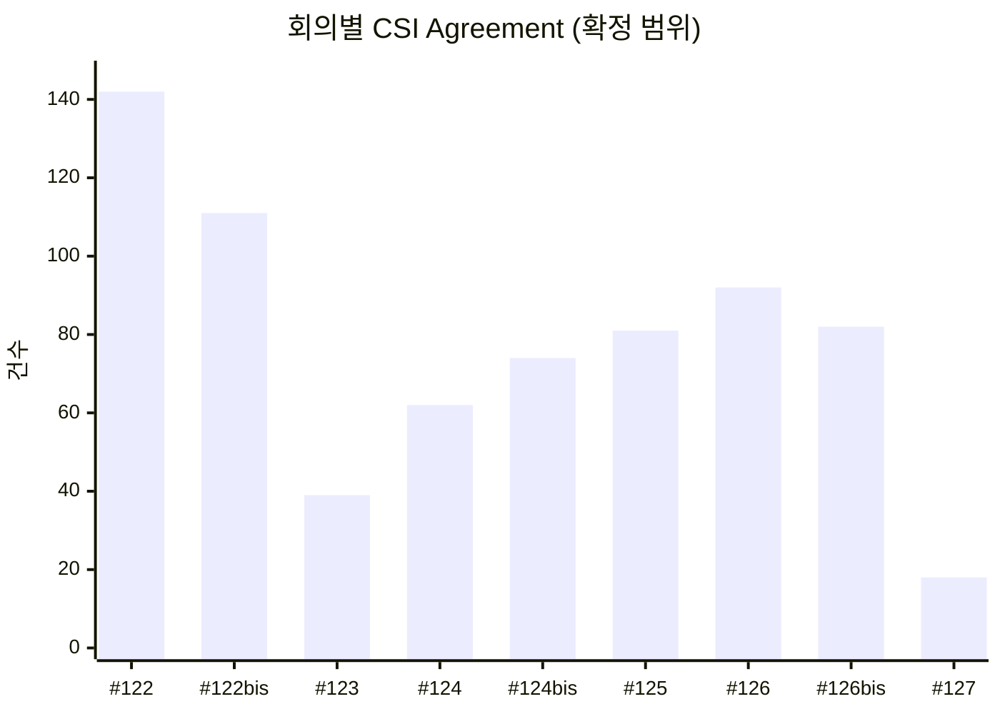

# RAN1 CSI 결정 대시보드

> 원본 DB 마지막 업데이트 **2026-11-19 13:30 KST** · 범위 RAN1#122 – #127 (9회) · [HTML 대시보드](https://jgunmoon.github.io/RAN1-CSI-Dashboard/) · 원본 [jgunmoon/RAN1-Decision-Tracker](https://github.com/jgunmoon/RAN1-Decision-Tracker)

> ⚠️ **RAN1#127는 '잠정'** 결과입니다 (`Chair notes RAN1#127_v09.docx` 기준, 회의 종료본 전). 결정이 바뀌거나 빠질 수 있습니다.

> ⚠️ **Agenda 확인 필요 (RAN1#126bis → RAN1#127)** — 결정이 범위에서 조용히 빠지지 않도록 확인하세요.
>
> - 포함 Agenda **CSI acquisition and report: Other aspects (TRS, DL+UL 결합 CSI 등)** (Rel-20 Study of 6GR): RAN1#126bis에 12건 → RAN1#127에 없음. 제목·섹션이 바뀌었으면 `config/csi_scope.yaml`의 agendas를 고칩니다.
> - 포함 Agenda **NR MIMO Phase 6 (상위 Agenda)** (Release 20 NR): RAN1#126bis에 13건 → RAN1#127에 없음. 제목·섹션이 바뀌었으면 `config/csi_scope.yaml`의 agendas를 고칩니다.
> - 포함 Agenda **AI/ML CSI compression Case 0 (Inference related aspects 등 하위 포함)** (Release 20 NR): RAN1#126bis에 5건 → RAN1#127에 없음. 제목·섹션이 바뀌었으면 `config/csi_scope.yaml`의 agendas를 고칩니다.
> - 포함 Agenda **Inter-vendor training collaboration for two-sided AI/ML models** (Release 20 NR): RAN1#126bis에 3건 → RAN1#127에 없음. 제목·섹션이 바뀌었으면 `config/csi_scope.yaml`의 agendas를 고칩니다.
> - 포함 Agenda **Maintenance on AI/ML·MIMO Ph5·NES·NTN (CSI 키워드·조항 있는 결정만)** (Maintenance on Rel-19 NR and E-UTRA): RAN1#126bis에 2건 → RAN1#127에 없음. 제목·섹션이 바뀌었으면 `config/csi_scope.yaml`의 agendas를 고칩니다.
>
> 확인했고 CSI와 무관하면 `acknowledged_alerts`에 아래 키를 넣으면 경고가 사라집니다: `RAN1#127: CSI acquisition and report: Other aspects (TRS, DL+UL 결합 CSI 등)`, `RAN1#127: NR MIMO Phase 6 (상위 Agenda)`, `RAN1#127: AI/ML CSI compression Case 0 (Inference related aspects 등 하위 포함)`, `RAN1#127: Inter-vendor training collaboration for two-sided AI/ML models`, `RAN1#127: Maintenance on AI/ML·MIMO Ph5·NES·NTN (CSI 키워드·조항 있는 결정만)`

3GPP RAN1 Chair notes의 결정 중 CSI 관련(CSI 획득·보고, CSI-RS, codebook, beam management, SRS, AI/ML CSI)만 모았습니다.
범위·주제 규칙은 [`config/csi_scope.yaml`](../config/csi_scope.yaml)에 있습니다. 이 파일은 자동 생성물이므로 직접 고치지 않습니다.

| 구분 | 건수 |
|---|---:|
| 확정 (포함 Agenda + 수동 포함) | **753** (Agreement 701 · WA 4 · Conclusion 48) |
| 후보 (다른 Agenda의 키워드 일치, 확인 필요) | 212 |

## 직전 회의 대비 (RAN1#126bis → RAN1#127)

확정 범위의 Agreement 수입니다. RAN1#127의 결정은 모두 이번 회의의 신규 결정입니다.

| 주제 | #126bis | **#127** | 증감 |
|---|---:|---:|---:|
| [AI/ML CSI](by_topic/aiml.md) | 7 | **0** | -7 |
| [SRS](by_topic/srs.md) | 24 | **7** | -17 |
| [Beam management](by_topic/beam.md) | 18 | **5** | -13 |
| [CSI 보고/codebook](by_topic/report.md) | 17 | **5** | -12 |
| [CSI-RS](by_topic/csirs.md) | 5 | **1** | -4 |
| [기타 CSI](by_topic/other.md) | 11 | **0** | -11 |
| **합계** | 82 | **18** | -64 |

## 주제별 · 회의별 Agreement

확정 범위의 Agreement만 셉니다. Working Assumption·Conclusion과 후보는 HTML 대시보드에서 체크박스로 켤 수 있습니다.
회의별 숫자는 결정마다 하나인 **주된 주제**로 셉니다. 한 결정이 여러 주제에 걸치면 나머지는 **관련 주제**로 붙고,
맨 끝 '관련 포함' 열은 관련 주제까지 센 전체 회의 합계라 합계가 전체 건수보다 큽니다.

| 주된 주제 | #122 | #122bis | #123 | #124 | #124bis | #125 | #126 | #126bis | #127 | 합계 | 관련 포함 |
|---|---:|---:|---:|---:|---:|---:|---:|---:|---:|---:|---:|
| [AI/ML CSI](by_topic/aiml.md) | 58 | 43 | 15 | 17 | 15 | 13 | 10 | 7 | · | **178** | 192 |
| [SRS](by_topic/srs.md) | 28 | 16 | 9 | 17 | 25 | 21 | 26 | 24 | 7 | **173** | 185 |
| [Beam management](by_topic/beam.md) | 15 | 3 | 3 | 15 | 11 | 22 | 31 | 18 | 5 | **123** | 144 |
| [CSI 보고/codebook](by_topic/report.md) | 21 | 33 | 5 | 8 | 14 | 14 | 13 | 17 | 5 | **130** | 379 |
| [CSI-RS](by_topic/csirs.md) | 4 | 1 | 1 | 4 | 8 | 9 | 9 | 5 | 1 | **42** | 190 |
| [기타 CSI](by_topic/other.md) | 16 | 15 | 6 | 1 | 1 | 2 | 3 | 11 | · | **55** | 55 |
| **합계** | **142** | **111** | **39** | **62** | **74** | **81** | **92** | **82** | **18** | **701** | — |

## 포함 Agenda별 · 회의별 Agreement

Agenda 번호는 회의마다 바뀌므로 '섹션 + Agenda 제목'으로 이어 붙였습니다. 괄호 안 번호는 가장 최근 회의 번호입니다.

| Agenda | #122 | #122bis | #123 | #124 | #124bis | #125 | #126 | #126bis | #127 | 합계 |
|---|---:|---:|---:|---:|---:|---:|---:|---:|---:|---:|
| Aspects of downlink-based CSI acquisition (Rel-20 Study of 6GR, 최근 10.5.3.1) | · | · | · | 5 | 17 | 18 | 20 | 21 | 6 | **87** |
| Aspects of uplink-based CSI acquisition (Rel-20 Study of 6GR, 최근 10.5.3.2) | · | · | · | 5 | 14 | 9 | 7 | 12 | 7 | **54** |
| Beam management for downlink and uplink (Rel-20 Study of 6GR, 최근 10.5.3.4) | · | · | · | 4 | 9 | 13 | 12 | 9 | 2 | **49** |
| Synchronization acquisition and beam measurement (Rel-20 Study of 6GR, 최근 10.5.1.1) | · | · | · | 6 | 1 | 8 | 15 | 8 | 3 | **41** |
| CSI acquisition and report: Other aspects (TRS, DL+UL 결합 CSI 등) (Rel-20 Study of 6GR, 최근 10.5.3.3) | · | · | · | 5 | 9 | 5 | 8 | 12 | · | **39** |
| NR MIMO Phase 6 (상위 Agenda) (Release 20 NR, 최근 9.2) | · | · | · | · | 7 | 14 | 15 | 12 | · | **48** |
| Enhancing DL CSI acquisition (Release 20 NR, 최근 9.2.2) | 8 | 12 | 5 | 9 | · | · | · | · | · | **34** |
| Improvement of SRS capacity and coverage (Release 20 NR, 최근 9.2.1) | 7 | 7 | 8 | 5 | · | · | · | · | · | **27** |
| AI/ML CSI compression Case 0 (Inference related aspects 등 하위 포함) (Release 20 NR, 최근 9.1.1) | 10 | 10 | 9 | 5 | 5 | 4 | 4 | 4 | · | **51** |
| Inter-vendor training collaboration for two-sided AI/ML models (Release 20 NR, 최근 9.1.2) | 5 | 2 | 2 | 4 | 3 | 5 | 4 | 2 | · | **27** |
| UE features for NR MIMO Phase N (Rel-19 UE Features, 최근 9.2) | 49 | 31 | · | · | · | · | · | · | · | **80** |
| Maintenance on NR MIMO Phase N (하위 포함) (Maintenance on Rel-19 NR and E-UTRA, 최근 8.2) | 20 | 18 | 11 | 8 | 7 | · | · | · | · | **64** |
| UE features for AI/ML (positioning 제외) (Rel-19 UE Features, 최근 9.1) | 19 | 18 | · | · | · | · | · | · | · | **37** |
| Maintenance on AI/ML (positioning 제외) (Maintenance on Rel-19 NR and E-UTRA, 최근 8.1) | 3 | 13 | 4 | 6 | 2 | · | · | · | · | **28** |
| Maintenance on AI/ML·MIMO Ph5·NES·NTN (CSI 키워드·조항 있는 결정만) (Maintenance on Rel-19 NR and E-UTRA, 최근 8.1) | · | · | · | · | · | 5 | 7 | 2 | · | **14** |
| AI/ML: Specification support for beam management (Maintenance on Rel-19 NR and E-UTRA, 최근 8.1.1) | 12 | · | · | · | · | · | · | · | · | **12** |
| AI/ML: Specification support for CSI prediction (Maintenance on Rel-19 NR and E-UTRA, 최근 8.1.3) | 9 | · | · | · | · | · | · | · | · | **9** |
| **합계** | **142** | **111** | **39** | **62** | **74** | **81** | **92** | **82** | **18** | **701** |

## RAN1#127 신규 CSI Agreement (18건)

아래 문장은 요약이 아니라 **원문 첫 줄**입니다(길면 자름). 전체 원문은 주제별 리포트와 HTML 대시보드에 있습니다.

| 주제 | Agenda | 원문 첫 줄 | 출처 |
|---|---|---|---|
| Beam management | 10.5.1.1 Synchronization acquisition and beam measurement | For 6GR PSS, | [Chair notes RAN1#127_v09](https://www.3gpp.org/ftp/Meetings_3GPP_SYNC/RAN1/Inbox/Chair_notes/Chair%20notes%20RAN1%23127_v09.docx) · `[127-R20-6GR-Synchronization and Beam Measurement]` |
| Beam management | 10.5.1.1 Synchronization acquisition and beam measurement | For 6GR SSS | [Chair notes RAN1#127_v09](https://www.3gpp.org/ftp/Meetings_3GPP_SYNC/RAN1/Inbox/Chair_notes/Chair%20notes%20RAN1%23127_v09.docx) · `[127-R20-6GR-Synchronization and Beam Measurement]` |
| Beam management | 10.5.1.1 Synchronization acquisition and beam measurement | For SSB design, downselect one from Alt 1 and Alt 2, | [Chair notes RAN1#127_v09](https://www.3gpp.org/ftp/Meetings_3GPP_SYNC/RAN1/Inbox/Chair_notes/Chair%20notes%20RAN1%23127_v09.docx) · `[127-R20-6GR-Synchronization and Beam Measurement]` |
| CSI 보고/codebook | 10.5.3.1 Aspects of downlink-based CSI acquisition | - For NW-triggered CSI reporting, support Aperiodic CSI reporting on PUSCH for both wideband and subband CSI … | [Chair notes RAN1#127_v09](https://www.3gpp.org/ftp/Meetings_3GPP_SYNC/RAN1/Inbox/Chair_notes/Chair%20notes%20RAN1%23127_v09.docx) · `[127-R20-6GR-Aspects of DL based CSI acquisition]` |
| CSI-RS | 10.5.3.1 Aspects of downlink-based CSI acquisition | For 6GR, the maximum number of CSI-RS ports is 256 | [Chair notes RAN1#127_v09](https://www.3gpp.org/ftp/Meetings_3GPP_SYNC/RAN1/Inbox/Chair_notes/Chair%20notes%20RAN1%23127_v09.docx) · `[127-R20-6GR-Aspects of DL based CSI acquisition]` |
| CSI 보고/codebook | 10.5.3.1 Aspects of downlink-based CSI acquisition | For the 6GR codebook design for CSI report, for sTRP, targeting different use cases, support W1W2 structure b… | [Chair notes RAN1#127_v09](https://www.3gpp.org/ftp/Meetings_3GPP_SYNC/RAN1/Inbox/Chair_notes/Chair%20notes%20RAN1%23127_v09.docx) · `[127-R20-6GR-Aspects of DL based CSI acquisition]` |
| CSI 보고/codebook | 10.5.3.1 Aspects of downlink-based CSI acquisition | For the 6GR codebook design for CSI report, for CJT, RAN 1 recommends to support at least one of the W1W2 str… | [Chair notes RAN1#127_v09](https://www.3gpp.org/ftp/Meetings_3GPP_SYNC/RAN1/Inbox/Chair_notes/Chair%20notes%20RAN1%23127_v09.docx) · `[127-R20-6GR-Aspects of DL based CSI acquisition]` |
| CSI 보고/codebook | 10.5.3.1 Aspects of downlink-based CSI acquisition | - For UE-assisted report for the 6GR DL based CSI, to facilitate CJT deployments, RAN 1 recommends to support… | [Chair notes RAN1#127_v09](https://www.3gpp.org/ftp/Meetings_3GPP_SYNC/RAN1/Inbox/Chair_notes/Chair%20notes%20RAN1%23127_v09.docx) · `[127-R20-6GR-Aspects of DL based CSI acquisition]` |
| CSI 보고/codebook | 10.5.3.1 Aspects of downlink-based CSI acquisition | For UE-assisted report for the 6GR DL based CSI, RAN 1 recommends to support Channel Property Information (CP… | [Chair notes RAN1#127_v09](https://www.3gpp.org/ftp/Meetings_3GPP_SYNC/RAN1/Inbox/Chair_notes/Chair%20notes%20RAN1%23127_v09.docx) · `[127-R20-6GR-Aspects of DL based CSI acquisition]` |
| SRS | 10.5.3.2 Aspects of uplink-based CSI acquisition | Support at least the following combinations of comb value and cyclic shift for comb values less than or equal… | [Chair notes RAN1#127_v09](https://www.3gpp.org/ftp/Meetings_3GPP_SYNC/RAN1/Inbox/Chair_notes/Chair%20notes%20RAN1%23127_v09.docx) · `[127-R20-6GR-Aspects of UL based CSI acquisition]` |
| SRS | 10.5.3.2 Aspects of uplink-based CSI acquisition | Support SRS repetition in 6GR. | [Chair notes RAN1#127_v09](https://www.3gpp.org/ftp/Meetings_3GPP_SYNC/RAN1/Inbox/Chair_notes/Chair%20notes%20RAN1%23127_v09.docx) · `[127-R20-6GR-Aspects of UL based CSI acquisition]` |
| SRS | 10.5.3.2 Aspects of uplink-based CSI acquisition | For DL CBW larger than 200MHz, for sounding of all parts of the target bandwidth over multiple transmissions … | [Chair notes RAN1#127_v09](https://www.3gpp.org/ftp/Meetings_3GPP_SYNC/RAN1/Inbox/Chair_notes/Chair%20notes%20RAN1%23127_v09.docx) · `[127-R20-6GR-Aspects of UL based CSI acquisition]` |
| SRS | 10.5.3.2 Aspects of uplink-based CSI acquisition | Support at least the following case of sharing one SRS transmission occasion for multiple usages: | [Chair notes RAN1#127_v09](https://www.3gpp.org/ftp/Meetings_3GPP_SYNC/RAN1/Inbox/Chair_notes/Chair%20notes%20RAN1%23127_v09.docx) · `[127-R20-6GR-Aspects of UL based CSI acquisition]` |
| SRS | 10.5.3.2 Aspects of uplink-based CSI acquisition | For 6GR, support at least the following interference randomization mechanisms | [Chair notes RAN1#127_v09](https://www.3gpp.org/ftp/Meetings_3GPP_SYNC/RAN1/Inbox/Chair_notes/Chair%20notes%20RAN1%23127_v09.docx) · `[127-R20-6GR-Aspects of UL based CSI acquisition]` |
| SRS | 10.5.3.2 Aspects of uplink-based CSI acquisition | For the following 2-level SRS frequency hopping patterns for 6GR: | [Chair notes RAN1#127_v09](https://www.3gpp.org/ftp/Meetings_3GPP_SYNC/RAN1/Inbox/Chair_notes/Chair%20notes%20RAN1%23127_v09.docx) · `[127-R20-6GR-Aspects of UL based CSI acquisition]` |
| SRS | 10.5.3.2 Aspects of uplink-based CSI acquisition | Support dynamic adaptation (other than RRC configuration) of at least one of the following parameters of SRS: | [Chair notes RAN1#127_v09](https://www.3gpp.org/ftp/Meetings_3GPP_SYNC/RAN1/Inbox/Chair_notes/Chair%20notes%20RAN1%23127_v09.docx) · `[127-R20-6GR-Aspects of UL based CSI acquisition]` |
| Beam management | 10.5.3.4 Beam management for downlink and uplink | At least for FR2, study UE UL beam sweeping for 6GR targeting at least Asymmetric DL sTRP and UL mTRP. | [Chair notes RAN1#127_v09](https://www.3gpp.org/ftp/Meetings_3GPP_SYNC/RAN1/Inbox/Chair_notes/Chair%20notes%20RAN1%23127_v09.docx) · `[127-R20-6GR-Beam management]` |
| Beam management | 10.5.3.4 Beam management for downlink and uplink | - Study the procedure of NW initiated UL beam sweeping considering, at least for FR2 | [Chair notes RAN1#127_v09](https://www.3gpp.org/ftp/Meetings_3GPP_SYNC/RAN1/Inbox/Chair_notes/Chair%20notes%20RAN1%23127_v09.docx) · `[127-R20-6GR-Beam management]` |

## 최근 변경 이력

실행마다 직전 결과와 비교한 기록입니다. 새 회의 결정은 '신규'로 보이지만, 원본이 **과거 회의**를 다시 처리해 생긴
추가·변경·삭제(파서 개선, 잠정 → 종료본 교체 등)는 여기서만 알 수 있습니다. 전체 기록은 `changes.json`에 있습니다.

| 시각 (UTC) | 이유 | 새 회의 | 기존 회의 추가 | 변경 | 삭제 |
|---|---|---|---:|---:|---:|
| 2026-11-19 08:51 | 원본 회의록 갱신 | — | 8 | 0 | 0 |
| 2026-11-18 08:36 | 원본 회의록 갱신 | RAN1#127 14건 | 0 | 0 | 0 |
| 2026-10-20 08:01 | 대시보드 범위 조정 (RAN1 회의록 변화 아님) | — | 25 | 68 | 2 |

가장 최근(2026-11-19) 기존 회의 변경 8건 펼치기

| 변경 | 회의 | 구분 | 범위 | Agenda | 원문 첫 줄 | id |
|---|---|---|---|---|---|---|
| 추가 | RAN1#127 | Agreement | 확정 | 10.5.1.1 Synchronization acquisition and beam measurement | For SSB design, downselect one from Alt 1 and Alt 2, | [`RAN1#127:10.5.1.1:003`](https://www.3gpp.org/ftp/Meetings_3GPP_SYNC/RAN1/Inbox/Chair_notes/Chair%20notes%20RAN1%23127_v09.docx) |
| 추가 | RAN1#127 | Agreement | 확정 | 10.5.3.1 Aspects of downlink-based CSI acquisition | For the 6GR codebook design for CSI report, for sTRP, targeting different use cases, support W1W2 structure based and W1W2Wf structure base… | [`RAN1#127:10.5.3.1:004`](https://www.3gpp.org/ftp/Meetings_3GPP_SYNC/RAN1/Inbox/Chair_notes/Chair%20notes%20RAN1%23127_v09.docx) |
| 추가 | RAN1#127 | Agreement | 확정 | 10.5.3.1 Aspects of downlink-based CSI acquisition | For the 6GR codebook design for CSI report, for CJT, RAN 1 recommends to support at least one of the W1W2 structure based and W1W2Wf struct… | [`RAN1#127:10.5.3.1:005`](https://www.3gpp.org/ftp/Meetings_3GPP_SYNC/RAN1/Inbox/Chair_notes/Chair%20notes%20RAN1%23127_v09.docx) |
| 추가 | RAN1#127 | Agreement | 확정 | 10.5.3.1 Aspects of downlink-based CSI acquisition | - For UE-assisted report for the 6GR DL based CSI, to facilitate CJT deployments, RAN 1 recommends to support CJT calibration (CJTC) report… | [`RAN1#127:10.5.3.1:006`](https://www.3gpp.org/ftp/Meetings_3GPP_SYNC/RAN1/Inbox/Chair_notes/Chair%20notes%20RAN1%23127_v09.docx) |
| 추가 | RAN1#127 | Conclusion | 확정 | 10.5.3.1 Aspects of downlink-based CSI acquisition | For study on PAPR reduction for JSCM-based CSI compression, deprioritize Option 2. | [`RAN1#127:10.5.3.1:007`](https://www.3gpp.org/ftp/Meetings_3GPP_SYNC/RAN1/Inbox/Chair_notes/Chair%20notes%20RAN1%23127_v09.docx) |
| 추가 | RAN1#127 | Agreement | 확정 | 10.5.3.1 Aspects of downlink-based CSI acquisition | For UE-assisted report for the 6GR DL based CSI, RAN 1 recommends to support Channel Property Information (CPI) reports at least for SD: | [`RAN1#127:10.5.3.1:008`](https://www.3gpp.org/ftp/Meetings_3GPP_SYNC/RAN1/Inbox/Chair_notes/Chair%20notes%20RAN1%23127_v09.docx) |
| 추가 | RAN1#127 | Agreement | 확정 | 10.5.3.2 Aspects of uplink-based CSI acquisition | Support dynamic adaptation (other than RRC configuration) of at least one of the following parameters of SRS: | [`RAN1#127:10.5.3.2:007`](https://www.3gpp.org/ftp/Meetings_3GPP_SYNC/RAN1/Inbox/Chair_notes/Chair%20notes%20RAN1%23127_v09.docx) |
| 추가 | RAN1#127 | WA | 후보 | 10.6.3 WUS operation with other functionalities | For UEs in RRC_CONNECTED and configured with DL-WUS and C-DRX in 6GR, if WUS is used to activate the C-DRX active time, RAN1 to support the… | [`RAN1#127:10.6.3:002`](https://www.3gpp.org/ftp/Meetings_3GPP_SYNC/RAN1/Inbox/Chair_notes/Chair%20notes%20RAN1%23127_v09.docx) |

## 후보가 많은 Agenda

포함 Agenda 밖에서 보조 키워드로 잡힌 결정입니다. CSI 관련이 맞으면 결정 id를 `include_ids`에, 아니면 `exclude_ids`에 적습니다.

| 섹션 | Agenda | 번호 | 후보 수 |
|---|---|---|---:|
| Maintenance on Rel-19 NR and E-UTRA | Maintenance on others | 8.2, 8.7, 8.8 | 45 |
| Maintenance on Rel-19 NR and E-UTRA | Maintenance on Evolution of NR duplex operation: Sub-band full duplex (SBFD) | 8.3 | 18 |
| Rel-19 UE Features | UE features for NR mobility enhancements Phase 4 | 9.6 | 15 |
| Rel-20 Study of 6GR | Uplink transmission scheme(s) for uplink channels | 10.5.2.3 | 15 |
| Maintenance on Rel-19 NR and E-UTRA | Measurements related enhancements for LTM | 8.9.1 | 10 |
| Rel-19 UE Features | UE features Batch C | 9.3 | 10 |
| Rel-20 Study of 6GR | Other physical layer signals, channels and procedure | 10.5.5 | 9 |
| Maintenance on Rel-19 NR and E-UTRA | Maintenance on Low-power wake-up signal and receiver for NR (LP-WUS/WUR) | 8.5, 8.6 | 7 |
| Rel-19 UE Features | UE features Batch B | 9.2 | 7 |
| Rel-20 Study of 6GR | Downlink transmission scheme(s) for downlink shared channels | 10.5.2.2 | 7 |
| Maintenance on Rel-19 NR and E-UTRA | CLI handling | 8.3.3 | 5 |
| Pre-Rel-19 NR Maintenance | Pre-Rel-19 NR Maintenance | 7 | 5 |
| Rel-20 Study of 6GR | Aspects of integration with communication | 10.8.2 | 5 |
| Maintenance on Rel-19 NR and E-UTRA | On-demand SSB SCell operation | 8.5.1 | 4 |
| Maintenance on Rel-19 NR and E-UTRA | Maintenance on Enhancements of network energy savings for NR | 8.5 | 3 |

---
모든 결정은 3GPP FTP의 Chair notes 원문 그대로이며, 각 결정 끝에 Chair notes와 근거 TDoc 링크를 붙였습니다.
이 리포트는 `python -m scripts.build`가 자동으로 생성합니다.
